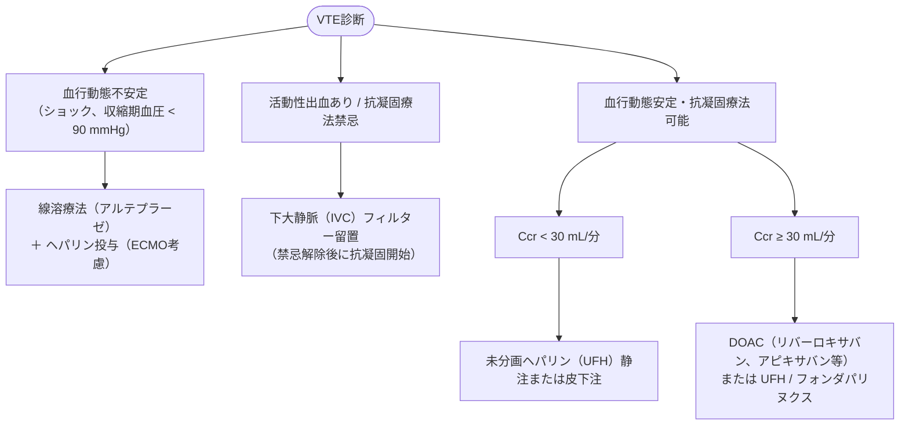

# 静脈血栓塞栓症 (VTE)
親カテゴリ: [[clinical-flows/A_心血管/index|A章 心血管]]

## 診断アルゴリズム

### 1. 検査前確率の評価
- **DVT疑い**: Wells criteria（DVT予測）で評価。
  - 低リスク（$\le0$点）：5%
  - 中リスク（1〜2点）：17%
  - 高リスク（$\ge3$点）：53%
- **肺血栓塞栓症（PE）疑い**: PERC rule、Wells criteria、revised Geneva score、4PEPSで評価。

> [!NOTE]- PERC Rule（PE Rule-Out Criteria）の8項目
> 以下のすべてを満たさない場合、PEは除外され造影CT等の追加検査は不要：
> 1. 年齢 $\ge50$ 歳
> 2. 心拍数 $\ge100$ 回/分
> 3. $\mathrm{SpO_2} \le94\%$
> 4. 片側下肢の浮腫
> 5. 血痰
> 6. 最近の外傷歴または手術歴
> 7. VTE（DVT/PE）の既往
> 8. エストロゲン製剤の使用

### 2. Dダイマーの判定基準
- **50歳未満**: $0.5\ \mu\mathrm{g/mL}$ をカットオフ。
- **50歳以上**: 年齢調整カットオフ値（**年齢 $\times 0.01\ \mu\mathrm{g/mL}$**）を使用。

### 3. 画像検査の選択
- **DVT**: 下肢静脈圧迫エコー（2-point US：大腿・膝窩静脈の圧迫性確認）を実施。
- **PE**: 臨床的除外ができない低リスク（Dダイマー陽性）および中〜高リスク群では、**造影CT（CT肺動脈造影）** を実施。

---

## 急性期治療プロトコル（発症〜5-10日）

### 薬剤別投与法（急性期）
- **リバーロキサバン**: 15 mg 1日2回（3週間） → 以後 15 mg 1日1回。
- **アピキサバン**: 10 mg 1日2回（7日間） → 以後 5 mg 1日2回。
- **エドキサバン**: UFH等による初期治療先行後、60 mg 1日1回（体重 $\le60$ kgまたはCcr 30〜50 mL/分で30 mgへ減量）。
- **未分画ヘパリン（UFH）**:
  - 静脈持続投与：初期 70 U/kg 静注 → 15 U/kg/時持続（APTT 63〜91秒を目標に調整）。
  - 皮下注法：初回 333 U/kg → 以後 250 U/kgを12時間毎（APTTモニター不要）。

> [!WARNING]- 下大静脈（IVC）フィルターの適応と注意
> - **絶対適応**: 急性VTEで抗凝固療法が禁忌の場合、抗凝固療法下でも進展するコントロール困難例。
> - 抗凝固療法が可能であれば、肺血栓塞栓症と下肢DVTの合併例であってもIVCフィルター併用のメリットはない（PREPIC2試験）。
> - 原則として除去可能型を用い、出血リスク解除後に速やかに抜去する。

---

## 慢性期治療と抗凝固療法の継続期間

- **一過性の誘因（手術、外傷、ギプス固定等）**: **3か月**で抗凝固療法を終了。
- **持続性の誘因（担癌状態、抗リン脂質抗体症候群等）**: **6か月以上継続**（再発リスクと出血リスクを天秤にかけ長期投与を検討）。
- **明らかな誘因のない特発性VTE**:
  - 悪性腫瘍のスクリーニングを実施（年齢に応じたがん検診、RIETE scoreの活用）。
  - 基本的に**6か月以上継続**。出血リスクが低ければ長期継続を考慮。

> [!NOTE]- 血栓後症候群（PTS）と弾性ストッキング
> DVT治療後に生じる慢性的な下肢疼痛、浮腫、色素沈着、皮膚硬化（Villalta scale $\ge5$ 点）。近年のRCT・メタアナリシスでは弾性ストッキングのルーチン装着によるPTS予防効果は否定的であり、症状に応じた装着や血管内治療の適応を検討する。
