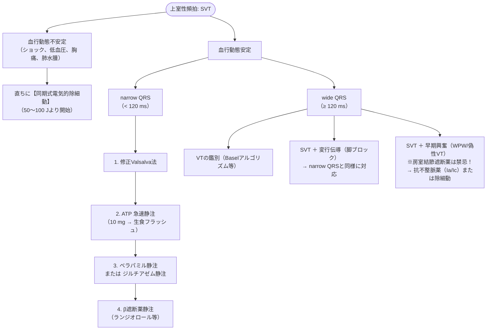

# 上室性頻拍 (SVT)
親カテゴリ: [[clinical-flows/A_心血管/index|A章 心血管]]

## 急性期マネジメント

### 1. 修正Valsalva法の手順
1. 45度半座位（ファウラー位）で、シリンジ筒先を吹くなどして40 mmHgの強制呼気を15秒間行わせる。
2. 息こらえ終了直後に患者を素早く仰臥位に倒し、下肢を他動的に45度挙上して15秒間維持する。
3. 元の座位に戻す。（洞調律復帰率は約43%）

### 2. 急性期使用薬剤のプロトコル
- **ATP（アデホス）**: **10 mgを三方活栓を用いて急速静注**し、直後に生食10〜20 mLで急速フラッシュ。（半減期10〜20秒。気管支痙攣リスクがあるため重症喘息では慎重投与）。
- **ベラパミル（ワソラン）**: 5 mgを3〜5分かけて緩徐に静注（最大15 mg）。※LVEF <40%やVT疑い例では心虚脱・血圧低下を来すため禁忌。
- **ランジオロール（オノアクト）**: 1 \UTF{00B5}g/kg/分で開始し適宜調節（超短時間作用型β遮断薬）。

> [!WARNING]- wide QRS頻拍における禁忌
> 副伝導路を介する早期興奮（WPW症候群に伴う心房細動・偽性VT）に対して、ATP、Caチャネル阻害薬、ジゴキシン、β遮断薬を投与すると、房室結節伝導のみがブロックされ副伝導路を介した伝導が激増し、**心室細動（VF）へ移行する危険**がある。迷ったら除細動またはプロカインアミド等のIa/Ic群を選択する。

---

## wide QRSにおける VT vs SVT の鑑別

> [!NOTE]- Basel Algorithm（3項目のうち2項目以上でVTと判定）
> 1. **器質的心疾患の存在**: 心筋梗塞既往、慢性心不全（LVEF <35%）、デバイス（ICD/CRT）留置
> 2. **II誘導**: 最初のピークまでの時間（RWPT） $>40\ \mathrm{ms}$
> 3. **aVR誘導**: 最初のピークまでの時間 $>40\ \mathrm{ms}$
> ※感度 91.5〜93.3%、特異度 88.7〜90.4%

---

## 慢性期マネジメント

### 1. 高リスク群の基準
- 早期興奮合併例（WPW症候群）
- 発作時に失神・血行動態不安定を来した例
- 職業上のリスク（高所作業員、職業運転手）
- 焦点心房頻拍（FAT：薬物抵抗性が多い）
- 急性期薬物治療への反応性が不良な例

### 2. 治療選択
- **カテーテルアブレーション**: 高リスク群、再発例、患者希望例で第一選択（成功率：AVNRT 97%、AVRT 92%）。
- **Pill-in-the-pocket（頓用法）**: 年数回程度で1時間以上持続する低リスク再発例に対し、発作時にベラパミル（40〜80 mg）やフレカイニド（50〜100 mg）を内服させる。
- **薬物予防療法**: β遮断薬、非ジヒドロピリジン系Caチャネル阻害薬を基本とし、難治例にはIc群（フレカイニド、プロパフェノン）を検討。
