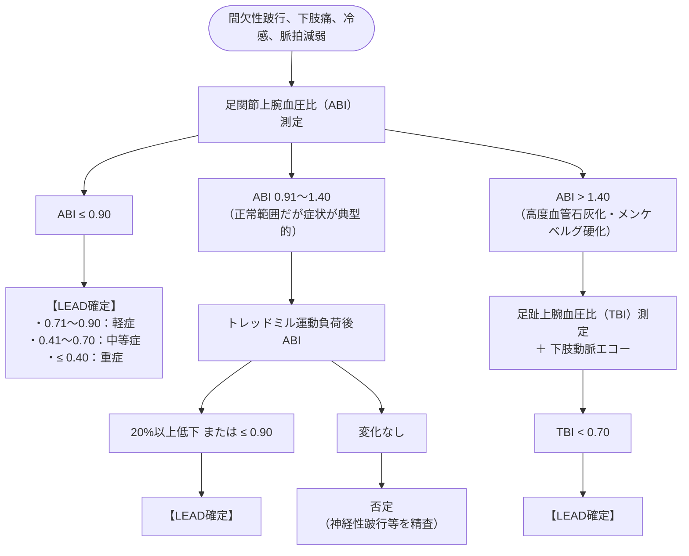

# 下肢閉塞性動脈疾患 (LEAD)
親カテゴリ: [[clinical-flows/A_心血管/index|A章 心血管]]

## 診断アルゴリズム

> [!NOTE]- 血管性間欠性跛行 vs 神経性間欠性跛行（脊柱管狭窄症）の鑑別
> - **血管性**: 歩行停止・立位保持のみで速やかに軽快する。疼痛部位は下腿（ふくらはぎ）が最多。
> - **神経性**: 立位でも疼痛が持続し、前傾姿勢（ショッピングカートサイン）や着座・屈曲位にならないと軽快しない。大腿部や臀部痛が多い。

---

## 治療マネジメント

### 1. 動脈硬化リスク介入（全例必須）
- **完全禁煙**: 切断リスク・死亡リスクを著明に低減。
- **脂質管理**: 強力なスタチン治療（目標 LDL-C $<70\ \mathrm{mg/dL}$ またはベースラインから50%以上低下）。
- **降圧療法**: 目標 $<130/80\ \mathrm{mmHg}$。ACE阻害薬またはARBを第一選択とする（歩行距離改善効果あり）。
- **血糖管理**: SGLT2阻害薬やメトホルミンの活用。

### 2. 間欠性跛行・症候性LEADに対する治療
- **運動療法（第一選択）**: 週3回以上、1回30分以上の監視下ウォーキング（最大耐用疼痛まで歩行）。最低6か月間継続。
- **抗血小板療法**:
  - **クロピドグレル（75 mg/日）** または **アスピリン（100 mg/日）** 単剤。
  - シロスタゾール（100〜200 mg/日 分2）：歩行距離延長効果。※心不全・不安定狭心症・重症不整脈では禁忌。
- **低用量リバーロキサバン＋アスピリン併用療法**:
  - 適応：冠動脈疾患合併例や血行再建術施行後の高リスクLEAD（COMPASS試験、VOYAGER PAD試験）。
  - リバーロキサバン 2.5 mg 1日2回 ＋ アスピリン 100 mg 1日1回（下肢虚血イベントおよび切断を有意に減少）。

### 3. 急性下肢虚血（ALI）および 包括的高度慢性下肢虚血（CLTI）
- 安静時疼痛、潰瘍、壊疽を伴う重症型。
- 直ちにヘパリンによる抗凝固療法を開始し、緊急で血行再建（カテーテル血管内治療 EVT または外科的バイパス術）を施行する。
