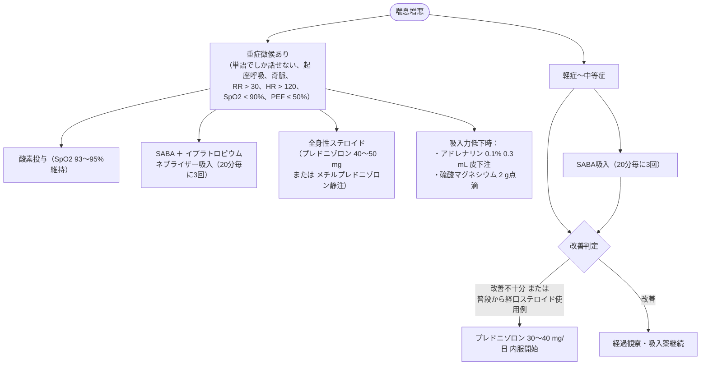

# 喘息
親カテゴリ: [[clinical-flows/B_呼吸器/index|B章 呼吸器]]

## 慢性期管理ステップ（GINA 2023 / JGL 2021準拠）

### 治療の2大アプローチ
- **Track 1（推奨：MART療法）**: 低用量ICS/ホルモテロール（シムビコート等）を**維持吸入＋発作時リリーバー**として兼用する。
- **Track 2（代替案）**: コントローラー（ICS/LABA）維持投与 ＋ リリーバーとしてSABA（サルタノール等）を頓用。

| ステップ | Track 1（MARTアプローチ：推奨） | Track 2（SABAリリーバー：代替案） | 追加オプション |
| :--- | :--- | :--- | :--- |
| **ステップ1-2** | 低用量ICS/ホルモテロール頓用のみ | 低用量ICS維持吸入 ＋ SABA頓用 | LTRA併用、アレルゲン免疫療法 |
| **ステップ3** | 低用量ICS/ホルモテロール維持 ＋ 頓用 | 中用量ICS または 低用量ICS/LABA ＋ SABA頓用 | LTRA併用 |
| **ステップ4** | 中用量ICS/ホルモテロール維持 ＋ 頓用 | 中〜高用量ICS/LABA ＋ SABA頓用 | LAMA追加、LTRA併用 |
| **ステップ5** | 高用量ICS/ホルモテロール ＋ LAMA（3剤併用） ＋ 生物学的製剤検討 | 高用量ICS/LABA ＋ LAMA ＋ 生物学的製剤検討 | 専門医紹介、経口ステロイド最小限 |

> [!NOTE]- MART（Maintenance and Reliever Therapy）のルール
> - **基本処方**: シムビコート 1回1〜2吸入 1日2回。
> - **発作時**: 症状出現時に1吸入。数分経過しても改善しなければ追加（1回発作あたり最大6吸入まで）。
> - **1日上限**: 通常合計8吸入まで（一時的に最大12吸入まで）。8吸入を超える場合は医療機関受診を指示。

### 重症喘息に対する生物学的製剤（ステップ5）
- **オマリズマブ（ゾレア）**: 抗IgE抗体。高IgE、通年性吸入アレルゲン陽性例。
- **メポリズマブ（ヌーカラ）/ ベンラリズマブ（ファセンラ）**: 抗IL-5 / 抗IL-5Rα抗体。血中好酸球増多（$\ge150\sim300\ /\mu\mathrm{L}$）例。
- **デュピルマブ（デュピクセント）**: 抗IL-4/13R抗体。FeNO高値、好酸球性炎症、アトピー性皮膚炎・好酸球性副鼻腔炎合併例。
- **テゼペルマブ（テゼスパイア）**: 抗TSLP抗体。上皮由来サイトカイン阻害、非好酸球性を含む広範な重症例。

---

## 急性増悪（発作）時の初期マネジメント

---

## アスピリン喘息（AERD / N-ERD）

> [!WARNING]- AERDにおけるステロイド静注・解熱鎮痛薬の厳重禁忌
> 1. **ステロイド急速静注の禁忌**: **コハク酸エステル製剤**（ソル・コーテフ、サクシゾン、水溶性プレドニン、ソル・メドロール）は激しい気管支痙攣を誘発する。必ず**リン酸エステル製剤**（デカドロン、リンデロン、水溶性ハイドロコートン）を投与する。
> 2. **NSAIDsの交差性**: COX-1阻害薬（ロキソプロフェン、アスピリン、ボルタレン、湿布剤・外用薬含む）は完全禁忌。
> 3. **安全に使用可能な鎮痛薬**:
>    - セレコキシブ（セレコックス：高選択的COX-2阻害薬）
>    - アセトアミノフェン（1回 $\le500$ mgまで。高用量ではCOX-1阻害を来し発作を誘発する）。
