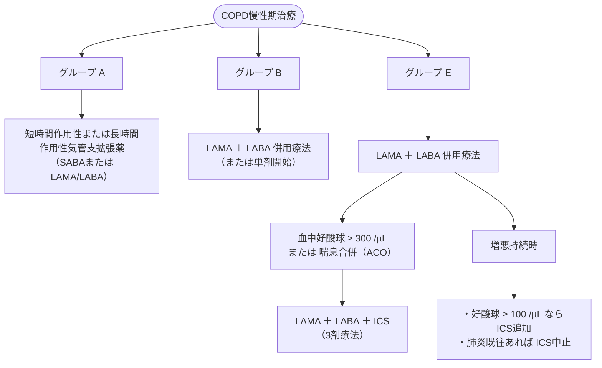

# 慢性閉塞性肺疾患 (COPD) の慢性期治療
親カテゴリ: [[clinical-flows/B_呼吸器/index|B章 呼吸器]]

## 診断と病期・重症度分類（GOLD 2024準拠）

- **確定診断**: 気管支拡張薬吸入後のスパイロメトリーで **$\mathrm{FEV_1/FVC} < 0.70$（閉塞性障害）** を確認。
- **気流制限の重症度（GOLD 1〜4）**:
  - GOLD 1（軽症）：$\mathrm{FEV_1} \ge80\%$
  - GOLD 2（中等症）：$\mathrm{FEV_1}\ 50\sim79\%$
  - GOLD 3（重症）：$\mathrm{FEV_1}\ 30\sim49\%$
  - GOLD 4（最重症）：$\mathrm{FEV_1} < 30\%$
- **臨床グループ分類（A, B, E）**:
  - **グループA**: mMRC 0〜1 かつ CAT <10、かつ過去1年間の増悪 0〜1回（入院なし）。
  - **グループB**: mMRC $\ge2$ または CAT $\ge10$、かつ過去1年間の増悪 0〜1回（入院なし）。
  - **グループE**: 過去1年間に $\ge2$ 回の中等度増悪、または入院を要する増悪 $\ge1$ 回（症状スコア問わず）。

---

## 安定期薬物治療アルゴリズム

> [!WARNING]- COPDにおける吸入ステロイド（ICS）の適応基準
> - **推奨される状況**: 血中好酸球数 $\ge300\ /\mu\mathrm{L}$、COPD増悪による入院歴あり、年間2回以上の増悪、喘息合併（ACO）。
> - **避けるべき状況**: 繰り返す肺炎の既往、血中好酸球数 $<100\ /\mu\mathrm{L}$、抗酸菌感染症の既往。
> ※不適切なICS使用は重症肺炎のリスクを有意に上昇させる。

---

## 非薬物療法と包括的管理

1. **禁煙（最重要介入）**: 肺機能低下曲線を健常非喫煙者レベルに改善させる唯一のエビデンス。
2. **ワクチン接種**: インフルエンザワクチン、肺炎球菌ワクチン（PPSV23 / PCV13/15/20）、COVID-19ワクチンの定期接種。
3. **呼吸リハビリテーション**: 運動耐容能改善、息切れ軽減、QOL向上（グループB・Eで必須）。
4. **在宅酸素療法（HOT）の適応基準**:
   - 安静時低酸素：$\mathrm{PaO_2} \le55\ \mathrm{mmHg}$ または $\mathrm{SpO_2} \le88\%$。
   - 肺高血圧症、肺性心、著明な赤血球増多を伴う場合：$\mathrm{PaO_2}\ 55\sim60\ \mathrm{mmHg}$（$\mathrm{SpO_2}\ 88\sim90\%$）。

---

## Asthma-COPD Overlap (ACO) の特徴

> [!NOTE]- ACOの診断と治療の要点
> - **特徴**: 40歳以上、持続性気流閉塞（$\mathrm{FEV_1/FVC} < 0.7$）に加えて、喘息の臨床的特徴（変動性の症状、気管支拡張薬への高可逆性、アトピー素因、喀痰・血中好酸球増多）を併せ持つ病態。
> - **治療原則**: COPD単独と異なり、**早期からの吸入ステロイド（ICS）併用が必須**。LAMA/LABA単独で管理してはならない。
