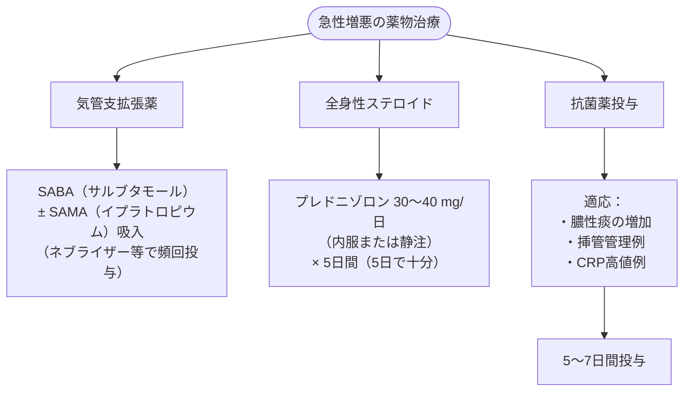

# 慢性閉塞性肺疾患 (COPD) の急性増悪治療
親カテゴリ: [[clinical-flows/B_呼吸器/index|B章 呼吸器]]

## 初期評価と鑑別診断

- **主症状**: 呼吸困難の増悪、喀痰量の増加、膿性痰への変化（Anthonisen 3徴）。
- **除外・併発疾患の検索**: 気胸、肺炎、うっ血性心不全、肺血栓塞栓症（PE：明らかな誘因のない増悪の約16%に潜む）。
- **動脈血液ガス分析**: 急性呼吸性アシドーシス（$\mathrm{pH} \le7.35$、$\mathrm{PaCO_2} >45\ \mathrm{mmHg}$）の有無を即座に判定。

---

## 呼吸不全への初期対応プロトコル

### 1. 制御された酸素療法
- **目標 $\mathrm{SpO_2}$**: **88〜92%**。
- ※高濃度酸素投与は高二酸化炭素血症・CO2ナルコーシスを誘発するため、ベンチュリーマスク等で調節。

### 2. 非侵襲的陽圧換気（NIV / BiPAP）の適応
- **適応基準**:
  - 急性呼吸性アシドーシス（$\mathrm{pH} \le7.35$ かつ $\mathrm{PaCO_2} \ge45\ \mathrm{mmHg}$）
  - 重篤な呼吸困難、呼吸筋疲労、奇異呼吸
- **初期設定目安**: S/Tモード、IPAP 8〜10 $\mathrm{cmH_2O}$、EPAP 4〜6 $\mathrm{cmH_2O}$。

### 3. 気管挿管・人工呼吸器管理の適応
- NIV不耐・失敗、意識障害、気道分泌物過多、血行動態不安定・ショック。

---

## 薬物治療の3本柱

### 抗菌薬の選択基準
- **非複雑性**（65歳未満、$\mathrm{FEV_1} >50\%$、増悪頻度年3回未満、心疾患なし）:
  - マクロライド系（アジスロマイシン）、セフェム系、ドキシサイクリン。
- **複雑性・緑膿菌リスク**（65歳以上、$\mathrm{FEV_1} \le35\%$、ステロイド長期使用、最近の抗菌薬使用歴）:
  - レボフロキサシン、ピペラシリン/タゾバクタム、セフェピム。

---

## 人工呼吸器管理における autoPEEP 対策

> [!WARNING]- 閉塞性肺障害のベンチレーター設定
> 呼気延長障害による動的肺過膨張（autoPEEP）および圧外傷・循環虚脱を防ぐため、以下の設定を遵守する：
> - **モード**: A/C従量式、1回換気量 6〜8 mL/kg（予測体重）。
> - **呼吸回数**: **8〜10回/分（呼気時間を極力長く確保）**。
> - **吸気流量**: 60〜80 L/分（短時間で吸気を終わらせる）。
> - **外因性PEEP**: 0〜5 $\mathrm{cmH_2O}$。
> - **許容性高二酸化炭素血症（Permissive hypercapnia）**: $\mathrm{pH} \ge7.20$ を保てる範囲で $\mathrm{PaCO_2}$ の上昇を容認する。
