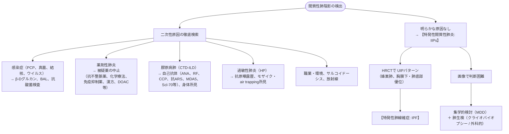

# 間質性肺疾患 (ILD)
親カテゴリ: [[clinical-flows/B_呼吸器/index|B章 呼吸器]]

## 診断アルゴリズムと原因検索

---

## 特発性肺線維症（IPF）のマネジメント

### 1. 診断の要点
- 50歳以上の男性に好発。HRCTにおける典型的なUIPパターン（胸膜下・基底面優位の網状影、蜂巣肺、牽引性気管支拡張）。
- **禁忌**: ステロイド単独やアザチオプリンとの併用療法は死亡リスクを増加させるため禁忌（PANTHER試験）。

### 2. 抗線維化薬治療
- **ピルフェニドン（ピレスパ）**: 600 mg/日より開始し最大 1800 mg/日。光線過敏症、食欲不振に注意。
- **ニンテダニブ（オフェブ）**: 150 mg 1日2回投与。下痢・肝機能障害に注意。急性増悪リスクを有意に半減させる。

---

## 進行性肺線維症（PPF / Progressive Pulmonary Fibrosis）

> [!NOTE]- PPFの定義（過去1年以内に以下の3項目中2項目以上を満たす）
> 1. 呼吸器症状の悪化
> 2. 呼吸機能の悪化（努力性肺活量 FVC $\ge5\%$ 低下、または DLco $\ge10\%$ 低下）
> 3. 画像上の線維化病変の進行（牽引性気管支拡張の拡大、新たなすりガラス影、蜂巣肺の拡大等）

- **治療アプローチ**:
  - 原疾患（膠原病肺、線維性過敏性肺炎、線維性NSIP等）を問わず、PPF基準を満たす場合は**抗線維化薬（ニンテダニブ）**の適応となる（INBUILD試験）。

---

## 膠原病に伴う間質性肺疾患（CTD-ILD）

- **高リスク病態**:
  - **抗MDA5抗体陽性皮膚筋炎**: 急速進行性間質性肺炎（RP-ILD）を来し極めて予後不良。直ちにステロイドパルス ＋ タクロリムス ＋ シクロホスファミドの3剤併用強力免疫抑制療法を施行。
  - **全身性強皮症（SSc-ILD）**: ニンテダニブ、トシリズマブ、シクロホスファミド、MMFが検討される。

> [!WARNING]- びまん性肺胞出血（DAH）の鑑別
> 血痰（1/3で欠如）、急激な貧血進行、すりガラス影。ANCA関連血管炎、抗GBM病、SLEで多発。直ちにステロイドパルスおよび血漿交換・シクロホスファミド導入を検討する。
