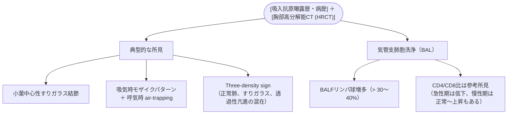

# 過敏性肺炎 (HP)
親カテゴリ: [[clinical-flows/B_呼吸器/index|B章 呼吸器]]

## 病型分類と主な吸入抗原

- **非線維性 HP（急性・亜急性）**: 抗原曝露後数時間〜数日で乾性咳嗽、発熱、呼吸困難が出現。抗原回避により速やかに軽快。
- **線維性 HP（慢性）**: 微量抗原の持続吸入により数か月〜数年かけて進行。不可逆的な肺線維化を来す。

### 代表的抗原と病型
1. **夏型過敏性肺炎（日本の急性の約75%）**:
   - 抗原：*Trichosporon asahii / T. mucoides*（湿った古い木造家屋・カビ）。夏季に悪化、入院や旅行で軽快。
2. **鳥関連過敏性肺炎（バード愛好家肺・羽毛布団肺：日本の慢性の約60%）**:
   - 抗原：鳥類（ハト、インコ、ニワトリ等）の糞・フケ・羽毛製品（ダウンジャケット、羽毛布団）。
3. **農夫肺**: カビの生えた干草（*Saccharopolyspora rectivirgula*）。
4. **加湿器肺・循環風呂肺**: 汚染された噴霧水中の真菌・マイコバクテリア。

---

## 診断基準と検査ステップ

> [!NOTE]- 特異抗体検査の活用
> - **イムノキャップ特異的IgG（鳥）**: ハト・セキセイインコ抗原に対するIgGを測定（保険適用）。急性鳥関連HPで感度87%。
> - **抗 *Trichosporon asahii* 抗体**: 夏型HPの疑診時に有用。

---

## 治療アプローチ

### 1. 抗原の完全隔離・回避（最重要）
- 非線維性HPは**抗原回避のみで完治可能**。
- 家屋の防カビ清掃、腐食木材の除去、エアコン・加湿器の交換、ペット鳥類の譲渡、羽毛布団の廃棄。

### 2. 薬物療法
- **非線維性HP（重症例）**: 抗原回避に加え、プレドニゾロン 40〜60 mg/日を1〜2週間投与後漸減。
- **線維性HP（炎症活動性あり）**: すりガラス影やBALFリンパ球高値例にプレドニゾロン 0.5 mg/kg/日を導入。効果不十分例には免疫抑制薬（AZA、MMF）併用。
- **進行性線維化例（PPF）**: 抗原回避・免疫抑制下でも線維化と呼吸機能低下が進行する場合、**抗線維化薬（ニンテダニブ）**を導入する。
