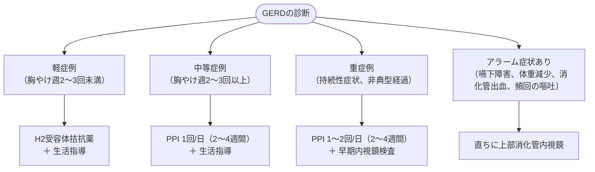

# 胃食道逆流症 (GERD)
親カテゴリ: [[clinical-flows/C_消化器/index|C章 消化器]]

## 重症度評価と治療フロー

---

## 内視鏡所見に基づく治療戦略

### 1. 非びらん性胃食道逆流症 (NERD) / 軽度食道炎 (LA分類 A, B)
- **初期治療**: PPI 通常量を 4〜8週間投与[cite: 178, 182]。
- **反応良好**: 投薬終了、または症状再燃時に頓用投与（on-demand）や最小量維持療法[cite: 178, 182]。
- **反応不十分**: PPI増量（1日2回投与：ラベプラゾール等）、高力価PPIへの変更、またはP-CAB（ボノプラザン 20 mg/日）へ変更[cite: 178, 180, 182]。

### 2. 重度食道炎 (LA分類 C, D)
- **初期治療**: **ボノプラザン（20 mg/日）** または PPI 通常量〜倍量を 4〜8週間投与（粘膜治癒率はP-CABが有意に優れる）[cite: 178, 182]。
- **治癒後**: 再発率が高いため、原則として**維持療法**（ボノプラザン 10 mg/日 または PPI 最小量）を継続[cite: 178, 180, 182]。

---

## 生活指導の重要項目

- **体位**: 就寝時の頭部挙上（ベッドの頭側を上げる）、左側臥位での就寝（右側臥位はLES圧低下を招く）[cite: 180]。食後2〜3時間は横臥を避ける[cite: 180]。
- **減量**: BMI >25 では腹圧低下のため強く推奨[cite: 180]。
- **食事**: 高脂肪食、柑橘類、トマト、コーヒー、チョコレート、アルコール、喫煙を控える[cite: 180]。
- **薬剤調整**: 下部食道括約筋（LES）圧を低下させる薬剤（Ca拮抗薬、硝酸薬、抗コリン薬、β作動薬）の中止・変更を検討[cite: 180]。

---

## Barrett 食道の管理

- **定義**: 胃から連続する円柱上皮が食道内に伸長した病態[cite: 184]。全周性かつ $\ge3$ cm を LSBE（Long-segment）、それ未満を SSBE（Short-segment）と呼ぶ[cite: 184]。
- **発癌リスク**: LSBE（0.76%/年）は SSBE（0.24%/年）と比較して高リスク[cite: 184]。
- **対応**:
  - 高度異形成・粘膜内癌：内視鏡的切除（ESD/EMR）や内視鏡的焼灼術の適応[cite: 178, 184]。
  - 低度異形成・LSBE：定期的な内視鏡サーベイランスおよびPPI/P-CABによる酸分泌抑制[cite: 178, 184]。

> [!WARNING]- PPI長期投与に伴う有害事象
> 長期投与により以下のリスクが上昇するため、定期的な漫然投与の見直しと最小有効量への減量・休薬を試みる[cite: 180, 182]：
> - 骨折リスク（カルシウム吸収阻害）[cite: 183]
> - 腸管感染症（*Clostridioides difficile* 腸炎）、市中肺炎・誤嚥性肺炎[cite: 180, 183]
> - 急性間質性腎炎および慢性腎臓病（CKD）の進展[cite: 180, 183]
> - ビタミンB12・鉄・マグネシウムの吸収低下[cite: 183]

> [!NOTE]- 機能性ディスペプシア (FD) との鑑別
> 典型的な逆流所見がなく、食後のもたれ感・早期飽満感が主体の場合は「食後愁訴症候群（PDS）」としてアコチアミド（アコファイド）等の運動機能改善薬を選択[cite: 184, 185, 186]。心窩部痛・灼熱感が主体の場合は「心窩部痛症候群（EPS）」として制酸薬や三環系抗うつ薬（TCA）を検討する[cite: 185, 186]。
