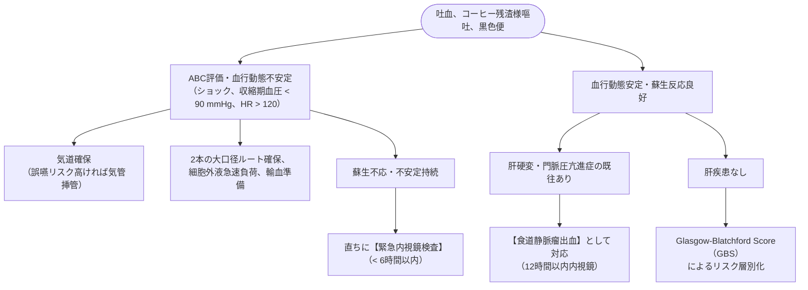

# 上部消化管出血
親カテゴリ: [[clinical-flows/C_消化器/index|C章 消化器]]

## 初期評価と蘇生（トリアージ）

---

## リスクスコア：Glasgow-Blatchford Score (GBS)

| 評価項目 | 条件とスコア |
| :--- | :--- |
| **BUN** | 18.2〜22.3 mg/dL (2点), 22.4〜27.9 (3点), 28.0〜69.9 (4点), $\ge70$ (6点) |
| **Hb (男性)** | 12.0〜12.9 g/dL (1点), 10.0〜11.9 (3点), $<10.0$ (6点) |
| **Hb (女性)** | 10.0〜11.9 g/dL (1点), $<10.0$ (6点) |
| **収縮期血圧** | 100〜109 mmHg (1点), 90〜99 (2点), $<90$ (3点) |
| **その他** | 脈拍 $\ge100$ 回/分 (1点), 黒色便 (1点), 失神 (2点), 肝疾患 (2点), 心不全 (2点) |

### GBSに基づくマネジメント
- **GBS 0〜1点（低リスク）**: 緊急内視鏡の必要性は極めて低く、外来診療・待機的内視鏡検査が可能[cite: 187, 189, 190]。
- **GBS $\ge2$ 点（中〜高リスク）**: 入院の上、**24時間以内に上部消化管内視鏡検査**を施行[cite: 187, 190]。GBS $\ge7$ 点は内視鏡的止血術が必要となる可能性が高く、$\ge11$ 点は死亡リスクが高い[cite: 189, 190]。

---

## 内視鏡前の初期薬物治療と輸血管理

1. **酸分泌抑制薬**:
   - オメプラゾール等の高用量PPI静注（初期 80 mg 静注 → 8 mg/時持続投与、または 40 mg 1日2回静注）を開始[cite: 190]。
2. **蠕動促進薬**:
   - 胃内視野改善目的にエリスロマイシン（250 mg点滴）またはメトクロプラミド（10 mg静注）を内視鏡直前に投与検討[cite: 190]。
3. **制限輸血戦略（Restrictive Transfusion）**:
   - **輸血開始閾値: Hb <7〜8 g/dL**（目標 Hb 7〜9 g/dL）[cite: 191]。
   - ※過剰な輸血（Hb >9〜10 g/dL目標）は門脈圧上昇・再出血率上昇・死亡率増加を招く（TRIGGER試験、Villanueva試験）[cite: 191]。ただし活動性大量出血・冠動脈疾患合併例は例外[cite: 191]。

---

## 抗血栓薬服用中患者の対応

> [!WARNING]- 抗血小板薬・抗凝固薬の休薬と再開基準
> - **急性期**: 原則として一時休薬するが、血栓高リスク群（冠動脈ステント留置後、DAPT中）では安易な全中止はステント血栓症（死亡リスク急増）を招く[cite: 191, 192]。
> - **アスピリン二次予防**: 内視鏡的止血完了後、**3日以内（可能なら即日〜翌日）に再開**する（早期再開は再出血率を軽度増やすが、全死亡率を有意に下げる）[cite: 191, 192]。
> - **DOAC / ワルファリン**: 止血確認後、血栓塞栓リスクを評価して速やかに再開[cite: 192]。
