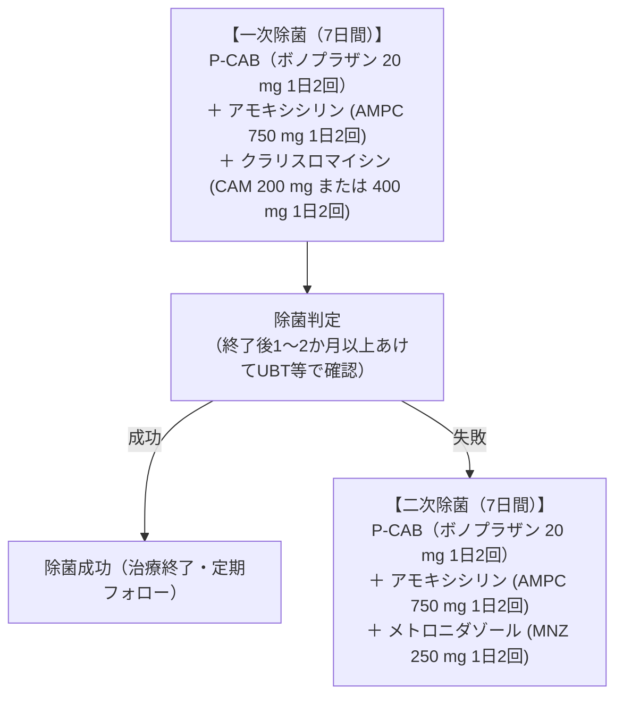

# Helicobacter pylori 菌の検査と除菌療法
親カテゴリ: [[clinical-flows/C_消化器/index|C章 消化器]]

## 検査法の選択と偽陰性対策

| 検査方法 | 感度/特異度 | 特徴・ピットフォール |
| :--- | :--- | :--- |
| **尿素呼気試験 (UBT)** | 感度 95% / 特異度 95% | 最も信頼性が高い。除菌判定の第一選択。PPI内服で偽陰性化[cite: 196]。 |
| **便中抗原検査** | 感度 91% / 特異度 80% | UBT困難例（小児・高齢者）に有用。上部消化管出血時は精度低下[cite: 196]。 |
| **血清・尿中抗体 (IgG)**| 感度 85% / 特異度 79% | 制酸薬の影響を受けないが、過去の感染既往でも陽性持続する[cite: 196]。 |
| **迅速ウレアーゼ試験** | 感度 90% / 特異度 >90% | 内視鏡生検時に実施。出血時やPPI使用下では感度低下[cite: 196]。 |

> [!WARNING]- 検査前の制酸薬休薬ルール
> 尿素呼気試験、便中抗原検査、迅速ウレアーゼ試験を行う際は、偽陰性を防ぐため**PPI/P-CABは検査前2週間以上休薬**、**H2RAは24〜48時間前休薬**とする[cite: 196]。

---

## 保険適用疾患

1. 胃潰瘍・十二指腸潰瘍[cite: 196]
2. 胃MALTリンパ腫[cite: 196]
3. 特発性血小板減少性紫斑病 (ITP)[cite: 196]
4. 早期胃癌に対する内視鏡的治療後胃[cite: 196]
5. **ヘリコバクター・ピロリ感染胃炎（内視鏡で慢性胃炎が確認されたもの）**[cite: 196]

---

## 除菌レジメン（国内標準プロトコル）

> [!NOTE]- P-CAB（ボノプラザン）とPPIの比較
> ボノプラザンをベースとした除菌レジメンは、従来のPPIベースレジメンに比べ、特にクラリスロマイシン耐性株において有意に高い除菌成功率を誇る（一次除菌成功率：約92.6% vs 75.9%）[cite: 197]。

> [!WARNING]- メトロニダゾール内服時の注意
> 二次除菌でメトロニダゾールを服用中は、ジスルフィラム様作用（悪心、顔面紅潮、動悸）を防ぐため、**完全禁酒**を徹底させる。
