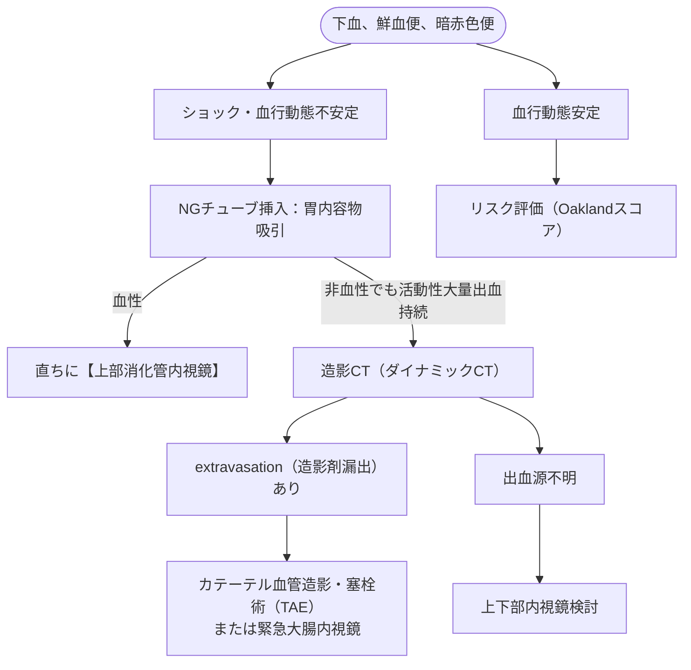

# 下部消化管出血
親カテゴリ: [[clinical-flows/C_消化器/index|C章 消化器]]

## 初期評価と上部消化管出血の除外

下部消化管出血（Treitz靭帯より肛門側からの出血）の約80〜85%は自然止血するが、大量出血・ショック例では上部消化管出血の迷入（血便・鮮血便の約15%が上部由来）を鑑別する[cite: 199, 200]。

---

## リスク層別化：Oakland Score

- **評価項目**: 年齢、性別、下部消化管出血入院歴、直腸指診所見、心拍数、収縮期血圧、ヘモグロビン値[cite: 200]。
- **判定**:
  - **$\le8$ 点**: 安全に外来加療・待機的精査が可能な低リスク群（再入院・輸血・処置を要する確率は5%未満）[cite: 200]。
  - **$>8$ 点**: 入院管理を推奨[cite: 200, 202]。$\ge20$ 点は重症出血・濃厚処置の高リスク[cite: 200]。

---

## 鑑別疾患と大腸内視鏡のタイミング

### 1. 主な原因疾患
1. **憩室出血 (30〜65%)**: 高齢者、突発性・無痛性の大量下血[cite: 201, 202]。NSAIDs服用がリスク[cite: 202]。自然止血率高い（約90%）が再発率も高い[cite: 202]。
2. **虚血性大腸炎 (5〜20%)**: 左側腹部〜下腹部痛を伴う下血[cite: 201, 203]。
3. **痔核 (5〜20%)**: 排便時の新鮮血付着[cite: 201, 203]。
4. **大腸ポリープ切除後出血 (2〜7%)**: 処置後数日〜14日目の遅発性出血に注意[cite: 201, 203]。
5. **血管異形成 / Angiodysplasia (5〜10%)**: 高齢者、大動脈弁狭窄症合併（Heyde症候群）[cite: 201, 202]。

### 2. 大腸内視鏡検査のタイミング
- 初期輸液蘇生によりバイタルサインが安定した患者では、**緊急大腸内視鏡（<24時間以内）をルーチンに行うメリットは乏しく、待機的内視鏡検査で十分**である（再出血率・死亡率に有意差なし）[cite: 201]。
