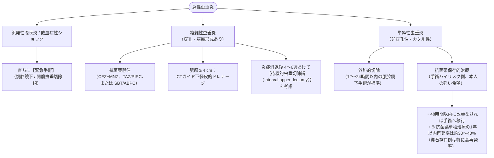

# 急性虫垂炎
親カテゴリ: [[clinical-flows/C_消化器/index|C章 消化器]]

## 臨床診断とスコアリング

- **典型症状**: 心窩部・臍周囲痛から右下腹部への疼痛の移動、嘔吐に先行する腹痛（感度100%）、食欲低下[cite: 204, 207]。
- **身体所見**: McBurney圧痛点、Blumberg徴候（反跳痛）、筋性防御、Rovsing徴候、Psoas徴候[cite: 204, 207]。

### Alvarado (MANTRELS) Score
- 症状の移動 (1), 食欲不振 (1), 悪心・嘔吐 (1), 右下腹部圧痛 (2), 反跳痛 (1), 発熱 $\ge37.3^\circ\mathrm{C}$ (1), 白血球増多 $\ge10000$ (2), 核左方移動 (1)[cite: 205]。
- **$\le4$ 点**: 虫垂炎の可能性低[cite: 205]。
- **5〜6点**: 虫垂炎疑い（CT等の画像評価推奨）[cite: 205]。
- **$\ge7$ 点**: 虫垂炎の可能性極めて高い[cite: 205]。

---

## 単純性 vs 複雑性のCT鑑別基準

> [!WARNING]- 複雑性虫垂炎（穿孔・膿瘍・壊疽）を示唆するCT所見
> 以下の所見を認める場合は「複雑性虫垂炎」と判断し、初期対応を変更する[cite: 205, 206]：
> 1. 虫垂壁の造影欠損（壊疽のサイン）[cite: 206]
> 2. 膿瘍形成（被包化された液体貯留）[cite: 206]
> 3. 腸管外フリーエアー（穿孔）[cite: 206]
> 4. 腸管外に脱落した糞石（Appendicolith）[cite: 206]
> 5. 高度の虫垂周囲脂肪織混濁、広範な腹水貯留[cite: 206]

---

## 治療マネジメントフロー

