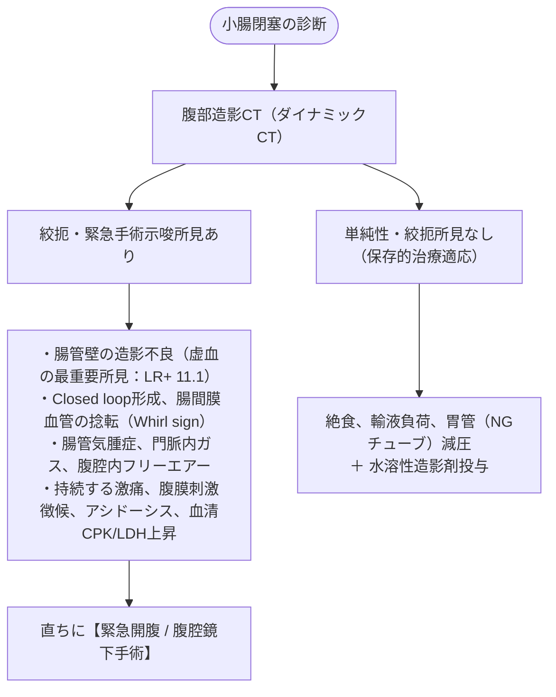

# 小腸閉塞 (SBO)
親カテゴリ: [[clinical-flows/C_消化器/index|C章 消化器]]

## 診断と絞扼性（緊急手術適応）の判定

小腸閉塞（イレウス）の原因の約70%は腹部手術後の**癒着性**である[cite: 214]。最も重要な責務は、血流障害を伴う「**絞扼性（strangulation）**」を即座に見抜くことである[cite: 214, 216]。

---

## 水溶性造影剤（ガストログラフイン）プロトコル

保存的治療が可能な単純性癒着性小腸閉塞に対し、診断と治療（浸透圧刺激による通過促進）を兼ねて実施する[cite: 217]。

1. **胃管より胃内容物を完全排液**する[cite: 217]。
2. **ガストログラフイン 50〜100 mL**（原液または同量の微温湯で希釈）を胃管から注入し、生食でフラッシュ後、チューブを**2時間クランプ**する[cite: 217]。
3. 2時間後にチューブを開放し、6時間後、12時間後、24時間後に腹部単純X線を撮影[cite: 217]。

### 判定と対応
- **24時間以内に結腸内に造影剤が到達**:
  - 部分閉塞（保存的加療成功）と判定。症状改善を確認し、経口摂取を再開検討[cite: 217]。
- **24時間経過しても造影剤が小腸内に停滞（結腸へ到達せず）**:
  - 完全閉塞・保存的治療失敗の可能性が高く、外科コンサルトを行い手術（またはイレウス管挿入）を考慮[cite: 217]。
- **保存的治療の中止基準**: 治療開始後48〜72時間経過しても改善しない場合、または胃管排液が $>500$ mL/日持続する場合[cite: 217]。

> [!WARNING]- ガストログラフイン投与時の禁忌
> ヨード過敏症患者には禁忌[cite: 217]。また、高浸透圧性であるため、嘔吐・誤嚥を起こすと致死的な化学性肺炎・ARDSを惹起する危険がある[cite: 217]。胃内容物の十分な脱血減圧を確認し、意識障害患者では慎重を期すこと[cite: 217]。
