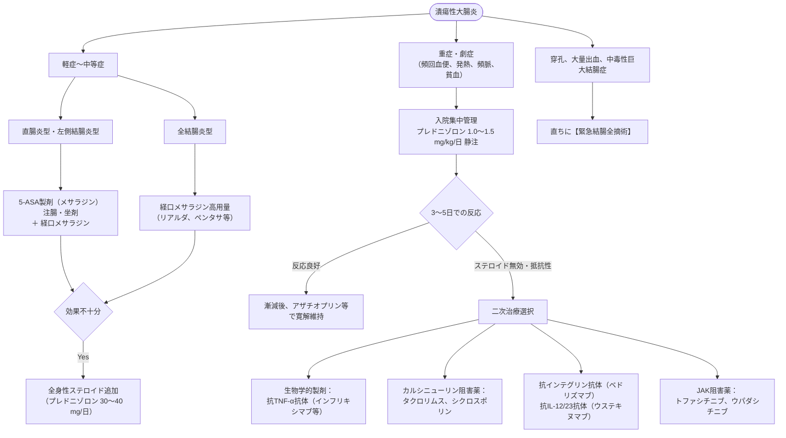

# 炎症性腸疾患 (IBD)：潰瘍性大腸炎・Crohn 病
親カテゴリ: [[clinical-flows/C_消化器/index|C章 消化器]]

## 疾患の基本対比

| 項目 | 潰瘍性大腸炎 (UC) | クローン病 (CD) |
| :--- | :--- | :--- |
| **病変部位** | 大腸に限局、直腸から**連続性**に口側へ進展[cite: 219] | 全消化管（特に回盲部好発）、**非連続性・跳躍病変**[cite: 219] |
| **炎症の深さ** | 粘膜〜粘膜下層（表層性）[cite: 219] | 全層性（透壁性：瘻孔、狭窄、膿瘍好発）[cite: 219] |
| **主症状** | 肉眼的粘血便、下痢、裏急後重[cite: 219, 221] | 腹痛、下痢、体重減少、発熱、難治性痔瘻・肛門病変[cite: 219, 221] |
| **内視鏡所見** | 血管透見像消失、易出血性、顆粒状粘膜、びらん[cite: 221] | 縦走潰瘍、敷石像（cobblestone appearance）、アフタ[cite: 221] |
| **組織学的特徴** | 陰窩膿瘍、杯細胞減少[cite: 221] | **非乾酪性類上皮細胞肉芽腫**[cite: 221] |
| **血清マーカー** | p-ANCA 陽性率高い[cite: 219, 220] | ASCA（抗酵母抗体）陽性率高い[cite: 219, 220] |

---

## 潰瘍性大腸炎 (UC) の治療マネジメント

---

## クローン病 (CD) の治療マネジメント

- **栄養療法**: 成分栄養剤（エレンタール）による腸管安静・抗原遮断。
- **寛解導入**:
  - 中等症〜重症: 全身性ステロイド（小腸・近位大腸限局なら腸溶性ブデソニド「ゼンタコート」9 mg/日も選択肢）[cite: 226, 227]。
  - 早期からの生物学的製剤導入（Top-down療法）: **抗TNF-α抗体（インフリキシマブ、アダリムマブ）**、抗IL-12/23抗体（ウステキヌマブ）、抗IL-23p19抗体（リサンキズマブ）、抗インテグリン抗体（ベドリズマブ）、JAK阻害薬（ウパダシチニブ）[cite: 226, 227, 230, 231]。
- **寛解維持**:
  - **チオプリン製剤（アザチオプリン 1〜2 mg/kg/日）** または導入成功した生物学的製剤の定期継続[cite: 226, 230]。
  - ※メサラジンはCDに対する寛解維持効果が極めて乏しいため、維持薬の主体としない[cite: 225]。

---

## 合併症とモニタリングの重要事項

> [!WARNING]- 重症UCにおけるサイトメガロウイルス (CMV) 感染の評価
> ステロイド抵抗性の重症UCでは、腸管組織でのCMV再活性化が高頻度にみられる[cite: 229]。大腸生検組織の病理（巨細胞・封入体）および組織CMV-DNA定量（PCR）を実施し、活動性感染があれば直ちにガンシクロビル静注を開始する[cite: 229]。

> [!NOTE]- 炎症性腸疾患における大腸癌サーベイランス
> - 罹患期間が8〜10年を超えた全結腸炎型・左側結腸炎型UC、および結腸の50%以上に病変を有するCDでは、大腸癌合併リスクが有意に上昇する[cite: 228]。
> - リスクに応じ、**1〜3年ごとの定期大腸内視鏡検査（色素散布・ステップ生検）**を実施する[cite: 228]。
