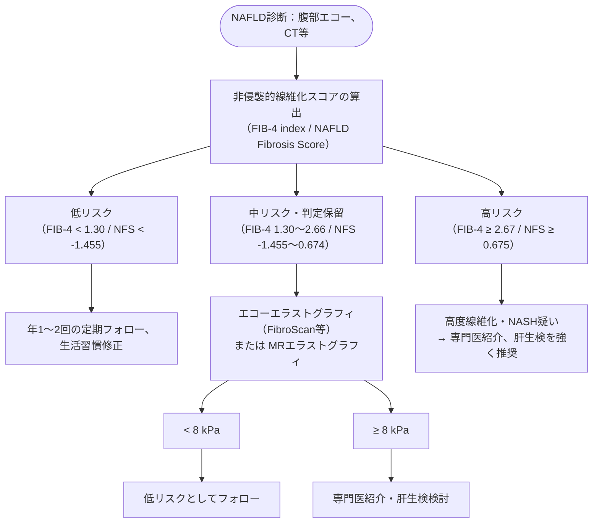

# 非アルコール性脂肪性肝疾患／非アルコール性脂肪肝炎 (NAFLD/NASH)
親カテゴリ: [[clinical-flows/D_肝・胆・膵/index|D章 肝・胆・膵]]

## 疾患概念と診断基準
飲酒歴がエタノール換算で**男性 <30 g/日、女性 <20 g/日**の患者における脂肪肝[cite: 238]。
- **NAFLD (MASLD)**: 単純性脂肪肝からNASHまでを含むスペクトラム[cite: 238]。
- **NASH (MASH)**: 肝細胞脂肪化に小葉内炎症、風船様変性（ballooning）、線維化を伴う進行性病態（肝硬変・肝癌の高リスク）[cite: 238, 241]。

---

## 線維化リスク評価アルゴリズム

### 算出式
- **FIB-4 index**: $\frac{\text{年齢} \times \text{AST}}{\text{血小板数}(\times 10^9/\mathrm{L}) \times \sqrt{\text{ALT}}}$[cite: 240]

---

## 治療マネジメント

### 1. 生活習慣改善（体重是正）
- **カロリー制限**: 1500 kcal/日目標、週175分以上の有酸素運動[cite: 240]。
- **目標**: **体重の7〜10%減量**（脂肪化のみならず肝組織線維化の退縮が得られる）[cite: 240]。

### 2. 薬物療法（NASH・線維化合併例）
- **ビタミンE（ユベラ 800 IU/日）**: 非糖尿病例のNASHにおいて抗酸化作用により肝組織所見を有意に改善[cite: 240]。
- **ピオグリタゾン（アクトス 15〜30 mg/日）**: インスリン抵抗性を改善し、脂肪沈着および肝組織線維化を抑制[cite: 240]。
- **GLP-1受容体作動薬（セマグルチド、リラグルチド）**: 肥満を伴う2型糖尿病合併NASHにおいて高い組織改善率[cite: 240, 241]。
- **SGLT2阻害薬**: 肝脂肪量低下、肝硬度改善効果[cite: 241]。
- **脂質異常症合併例**: スタチン（心血管イベント予防）またはフィブラート系薬の投与[cite: 239, 241]。
