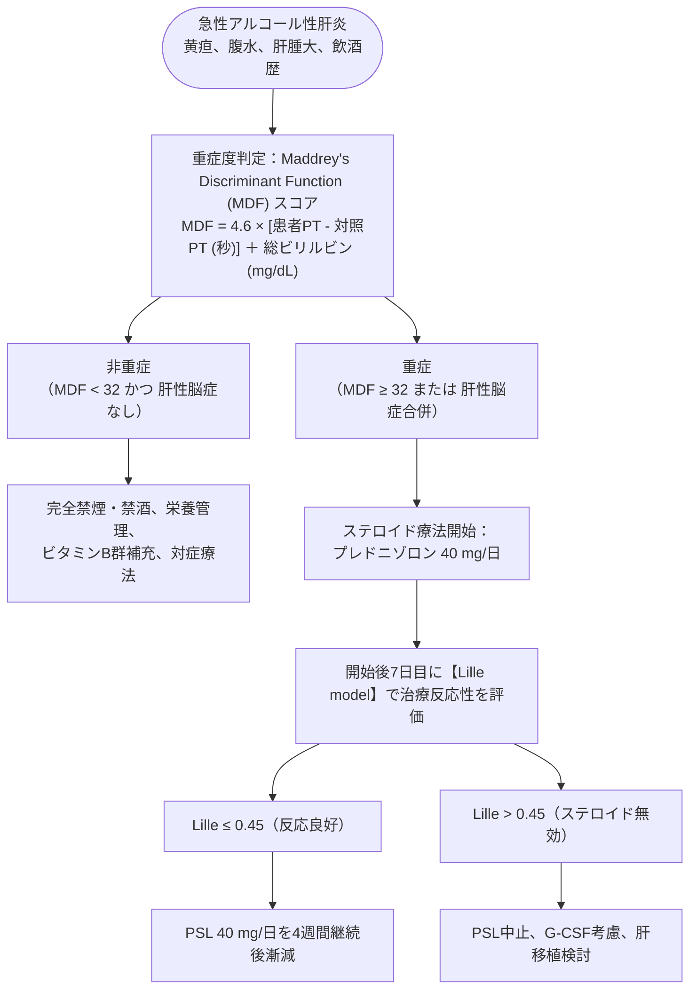

# アルコール性肝障害
親カテゴリ: [[clinical-flows/D_肝・胆・膵/index|D章 肝・胆・膵]]

## 診断基準と生化学的特徴

- **飲酒歴**: エタノール換算で**男性 $\ge60$ g/日、女性 $\ge40$ g/日**が5年以上（受診前8週以内まで飲酒）[cite: 243, 247]。
- **酵素パターン**: **AST/ALT 比 $\ge2.0$** が特徴的（ALT合成に必要なビタミンB6の欠乏による）[cite: 243, 247]。ASTの絶対値は通常 **<400 IU/L** にとどまる[cite: 234, 243]。
- 著明な白血球増多（しばしば $15000\sim18000\ /\mu\mathrm{L}$、ときに類白血病反応）を伴う[cite: 243]。

---

## 重症急性アルコール性肝炎のマネジメント

> [!WARNING]- ステロイド無効例（Lille >0.45）における感染症リスク
> ステロイド無効例にPSLを漫然と継続すると、致死的な重症細菌・真菌感染症を併発し予後を悪化させる。7日目のLilleスコアが >0.45 の場合は即座にステロイドを中止する[cite: 244, 245]。

---

## 基礎治療プロトコル

1. **完全断酒**: 最も基本的かつ予後を規定する介入[cite: 242, 245]。離脱症状の予防（ベンゾジアゼピン系薬）を並行[cite: 242, 245]。
2. **栄養療法**:
   - エネルギー：35〜40 kcal/kg/日、タンパク質：1.2〜1.5 g/kg/日[cite: 245]。
   - **ビタミンB1（チアミン 100〜200 mg/日）**: ウェルニッケ脳症予防のためブドウ糖投与前に必ず先行投与[cite: 245]。
   - 葉酸、ビタミンB6、ナイアシンの積極的補充[cite: 245]。
3. **進行線維化の評価**: FIB-4 index $\ge3.25$ またはエラストグラフィ $\ge15\ \mathrm{kPa}$ で進行期線維化・肝硬変と判定し、肝細胞癌サーベイランスを開始する[cite: 245]。
