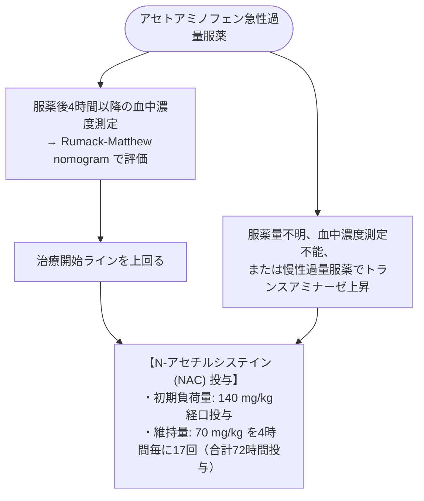

# 薬物性肝障害 (DILI)
親カテゴリ: [[clinical-flows/D_肝・胆・膵/index|D章 肝・胆・膵]]

## 病型分類とR比（R ratio）

初認時の肝酵素値より $R$ 比を計算して病型を分類する[cite: 247, 249]：
$$\text{R比} = \frac{\text{ALT} / \text{ALT基準上限 (ULN)}}{\text{ALP} / \text{ALP基準上限 (ULN)}}$$[cite: 249]

- **肝細胞障害型 (R $\ge5$)**: アセトアミノフェン、NSAIDs、イソニアジド、抗てんかん薬等[cite: 247, 249]。
- **胆汁うっ滞型 (R $\le2$)**: アモキシシリン/クラブラン酸、マクロライド、クロピドグレル等[cite: 247, 249]。
- **混合型 (2 < R < 5)**: クリンダマイシン、ST合剤、アザチオプリン等[cite: 247, 249]。

---

## 薬剤中止基準（Hy's Law）

> [!WARNING]- 劇症化を予測する即時中止基準
> 以下のいずれかを満たす場合は、不可逆的な肝不全・劇症化リスクが高いため被疑薬を直ちに中止する[cite: 247, 249]：
> 1. **ALT $>8 \times \mathrm{ULN}$**（単回でも）[cite: 247, 249]
> 2. **ALT $>5 \times \mathrm{ULN}$ が2週間以上持続**[cite: 247, 249]
> 3. **ALT $>3 \times \mathrm{ULN}$ かつ 総ビリルビン $>2 \times \mathrm{ULN}$**（Hy's Law：死亡率約10%）[cite: 247, 249]
> 4. **ALT $>3 \times \mathrm{ULN}$ かつ PT-INR $>1.5$**[cite: 247, 249]

---

## アセトアミノフェン中毒の初期治療

大量服薬後、毒性代謝産物 NAPQI がグルタチオンを枯渇させて広範な肝細胞壊死を引き起こす[cite: 250]。
> [!NOTE]- アセトアミノフェン肝不全の移植適応（King's College Criteria）
> 以下のいずれかを満たす場合は緊急肝移植の適応となる（内科的死亡率 80〜90%）[cite: 252]：
> 1. 動脈血 $\mathrm{pH} < 7.30$（蘇生後）[cite: 252]
> 2. 24時間以内に以下の3項目すべてを満たす：
>    - III度以上の肝性脳症[cite: 252]
>    - PT $>100$ 秒（INR $>6.5$）[cite: 252]
>    - 血清クレアチニン $>3.4\ \mathrm{mg/dL}$[cite: 252]
> 3. 乳酸値 $>3.5\ \mathrm{mmol/L}$（初期輸液4時間後）[cite: 252]
