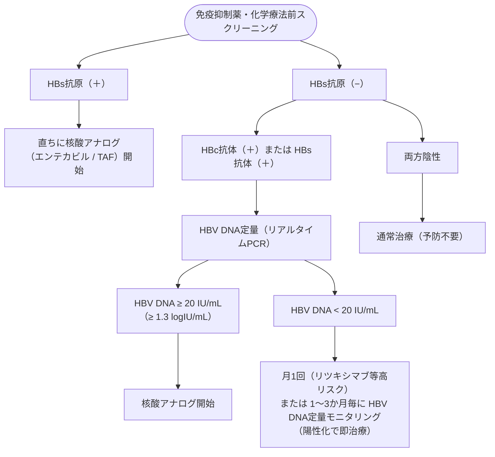

# ウイルス性慢性肝炎
親カテゴリ: [[clinical-flows/D_肝・胆・膵/index|D章 肝・胆・膵]]

## B型肝炎 (HBV)

### 1. スクリーニングと血清学的判定
- **スクリーニング項目**: HBs抗原、HBc抗体、HBs抗体[cite: 253, 254]。
- **既往感染（潜在性感染）**: HBs抗原陰性 かつ HBc抗体陽性（またはHBs抗体陽性）[cite: 253, 254]。

### 2. 免疫抑制薬・化学療法時の再活性化予防（De novo B型肝炎）

> [!WARNING]- 核酸アナログの投与継続期間
> 免疫抑制療法終了後も自己判断で中止してはならない。既往感染者では治療終了後**少なくとも12か月間**は核酸アナログ投与を継続し、DNA陰性化・ALT正常化を確認して専門医判断で終了する[cite: 255]。

---

## C型肝炎 (HCV)

### 1. 治療適応
- 非代償性肝硬変を除くすべてのHCV RNA陽性患者が抗ウイルス療法の対象[cite: 256]。
- 特に ALT $>30\ \mathrm{IU/L}$、血小板 $<15$ 万/$\mu\mathrm{L}$、または進行した線維化例は肝癌予防の観点から最優先[cite: 256]。

### 2. IFNフリー直接作用型抗ウイルス薬 (DAA) レジメン
- **パンゲノタイプ（1〜6型共通）**:
  - **マヴィレット配合錠**（グレカプレビル/ピブレンタスビル）：1日1回 3錠、食後8週間（非肝硬変）または12週間（代償性肝硬変）[cite: 257]。
  - **エプクルーサ配合錠**（ソホスブビル/ベルパタスビル）：非代償性肝硬変（Child-Pugh B, C）にも適応あり（12週間）[cite: 257]。
- **SVR（著効）達成後**: ウイルス排除後も肝発癌リスクは残存するため、特に高齢・線維化進行例では年2回の画像スクリーニングを継続する[cite: 256, 257]。
