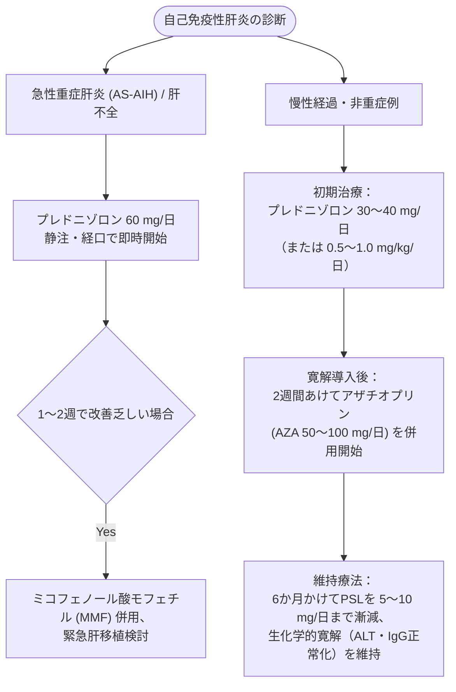

# 自己免疫性肝炎 (AIH)
親カテゴリ: [[clinical-flows/D_肝・胆・膵/index|D章 肝・胆・膵]]

## 疾患特性と診断基準
中高年女性に好発する進行性肝炎[cite: 258]。血清 **IgG上昇**、自己抗体陽性（**抗核抗体 ANA、抗平滑筋抗体 SMA**）、病理所見（**インターフェイス肝炎**、形質細胞浸潤）が特徴[cite: 258, 260, 261]。

### 簡易スコアリングシステム（Simplified Criteria）
1. 自己抗体：ANA または SMA $\ge1:40$ (1点)、$\ge1:80$ または 抗LKM-1 $\ge1:40$ (2点)[cite: 261]
2. IgG：$>$ ULN (1点)、$>1.1 \times \mathrm{ULN}$ (2点)[cite: 261]
3. 肝組織所見：AIHに合致 (1点)、AIHに典型的 (2点)[cite: 261]
4. ウイルスマーカー：HAV, HBV, HCV すべて陰性 (2点)[cite: 261]
- **判定**: 6点で probable AIH、**$\ge7$ 点で definite AIH**（感度81%、特異度99%）[cite: 261]。

---

## 治療プロトコル

> [!WARNING]- アザチオプリン投与前の NUDT15 遺伝子検査
> 日本人を含む東アジア人では、*NUDT15* 遺伝子多型により重篤な早期白血球減少・全脱毛を来す頻度が高い。投与前に必ず *NUDT15* 遺伝子検査を行い、ホモ変異（Cys/Cys）では投与回避、ヘテロ変異では減量投与を行う[cite: 262]。

> [!NOTE]- 免疫抑制療法の終了基準
> 生化学的寛解が最低2年以上継続し、組織学的寛解が確認された場合に限り慎重な漸減・中止を考慮するが、中止後の再燃率は60〜80%と極めて高いため、原則として少量のAZAまたはPSLによる長期維持療法が推奨される[cite: 259, 263]。
