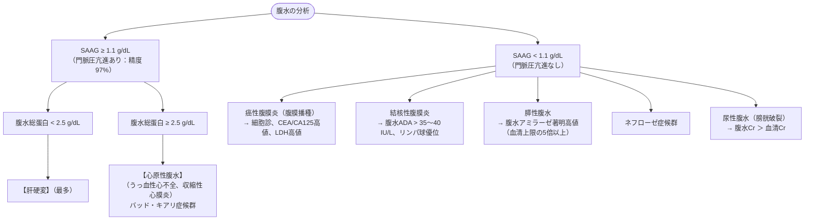

# 腹水検査
親カテゴリ: [[clinical-flows/D_肝・胆・膵/index|D章 肝・胆・膵]]

## 門脈圧亢進症の鑑別：SAAG

従来の「漏出性／滲出性」ではなく、**Serum-Ascites Albumin Gradient (SAAG)** を用いて病態を分類する[cite: 283]。
$$\text{SAAG} = \text{血清アルブミン値} - \text{腹水アルブミン値}$$[cite: 283]

---

## 感染性腹水の診断基準

- **特発性細菌性腹膜炎 (SBP)**:
  - **腹水好中球数 $\ge250\ /\mu\mathrm{L}$**[cite: 284]。
  - ※血性穿刺時は、赤血球 250〜500個につき好中球を1個差し引いて補正する[cite: 284]。
- **細菌保有腹水 (Bacterascites)**:
  - 腹水好中球数 $<250\ /\mu\mathrm{L}$ だが培養陽性[cite: 275]。無症状なら経過観察、発熱・腹痛があれば治療[cite: 275]。
- **二次性腹膜炎（消化管穿孔等）の示唆所見**:
  - 腹水総蛋白 $>1.0\ \mathrm{g/dL}$、ブドウ糖 $<50\ \mathrm{mg/dL}$、LDH $>$ 血清上限値、多菌種検出。

---

## 特殊な腹水の鑑別

- **乳び腹水**: 外観は乳白色混濁、**腹水中トリグリセリド (TG) $>200\ \mathrm{mg/dL}$**（リンパ管損傷、リンパ腫、肝硬変）[cite: 286]。
- **癌性腹水**: 診断率向上のため、細胞診は**最低 200〜300 mL** の検体を提出する（セルブロック併用）[cite: 285]。
