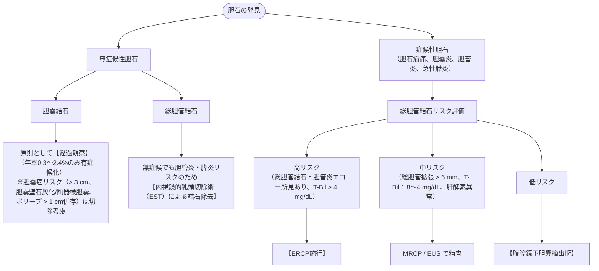

# 胆石
親カテゴリ: [[clinical-flows/D_肝・胆・膵/index|D章 消化器]]

## 臨床分類とトリアージ

---

## 治療アプローチ

### 1. 症候性胆嚢結石
- **標準治療**: **腹腔鏡下胆嚢摘出術**（再発疝痛率は年間38〜50%に達するため手術が第一選択）[cite: 287, 290]。
- **内科的胆石溶解療法（手術ハイリスク・拒否例）**:
  - 適応：**コレステロール結石**（石灰化なし・CT値 $<60\ \mathrm{HU}$）、結石径 $<15\ \mathrm{mm}$、胆嚢収縮能保持[cite: 291]。
  - 処方：**ウルソデオキシコール酸 (UDCA 600 mg/日)** を長期投与[cite: 287, 291]。

### 2. 総胆管結石
- 内視鏡的逆行性胆管膵管造影（ERCP）下に、乳頭括約筋切開術（EST）または乳頭バルーン拡張術（EPBD）を行い結石を除去[cite: 290]。
- 総胆管結石除去後も、胆嚢結石が残存していれば再発予防目的に**腹腔鏡下胆嚢摘出術**を追加する[cite: 290]。
