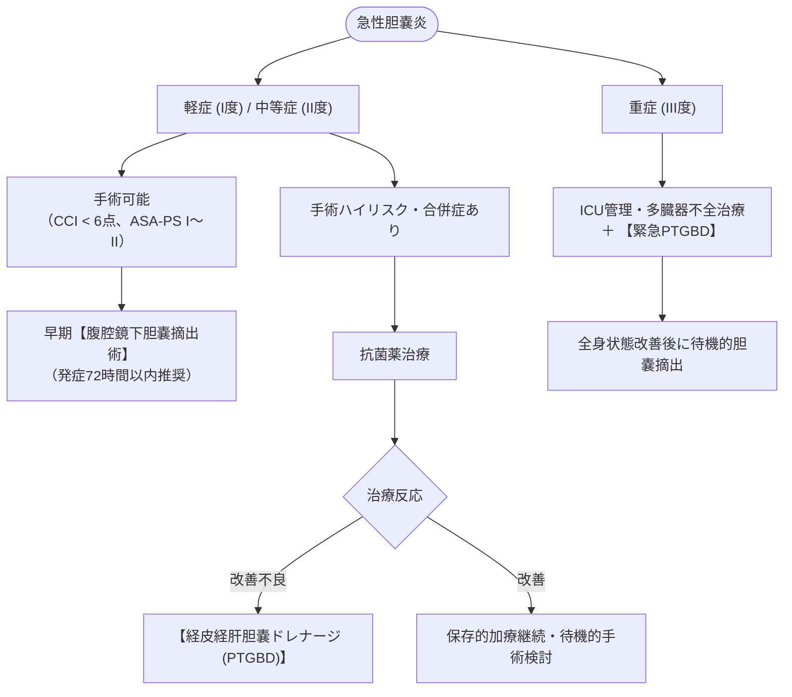
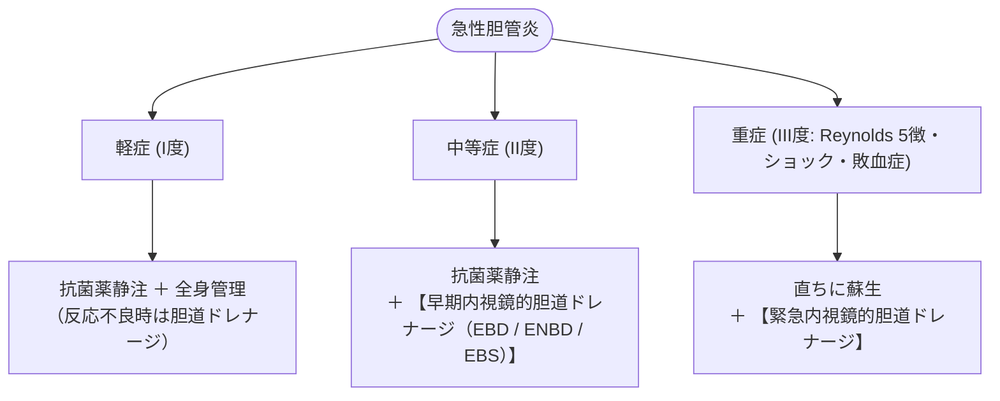

# 急性胆嚢炎、急性胆管炎
親カテゴリ: [[clinical-flows/D_肝・胆・膵/index|D章 肝・胆・膵]]

## 重症度判定基準 (Tokyo Guidelines 2018 / TG18)

- **重症（III度）**: いずれかの臓器機能障害（心血管系：ショック、神経系：意識障害、呼吸器系：$\mathrm{PaO_2/FiO_2} <300$、腎：$\mathrm{Cr} >2.0$、血液：血小板 $<10$ 万、肝：INR $>1.5$）を合併[cite: 295]。
- **中等症（II度）**:
  - 胆嚢炎：白血球 $>18000\ /\mu\mathrm{L}$、右上腹部腫瘤触知、症状持続 $>72$ 時間、局所合併症（壊疽、気腫、膿瘍）[cite: 295]。
  - 胆管炎：白血球 $>12000$ または $<4000\ /\mu\mathrm{L}$、体温 $\ge39^\circ\mathrm{C}$、年齢 $\ge75$ 歳、総ビリルビン $\ge5.0\ \mathrm{mg/dL}$、低アルブミン血症[cite: 295]。
- **軽症（I度）**: 上記の重症・中等症の基準を満たさないもの[cite: 295]。

---

## 急性胆嚢炎の治療フロー

---

## 急性胆管炎の治療フロー

---

## 抗菌薬選択プロトコル

血液培養2セット採取後に即時投与開始[cite: 296]。主な起因菌は *E. coli*, *Klebsiella*, *Enterobacter*, 嫌気性菌[cite: 296]。

| 重症度 | 推奨レジメン | 代替レジメン |
| :--- | :--- | :--- |
| **軽症（I度）** | セフトリアキソン (CTRX 1〜2 g 24時間毎) ＋ メトロニダゾール (MNZ 500 mg 8時間毎)[cite: 297] | セフメタゾール (CMZ 1〜2 g 8〜12時間毎)[cite: 297] |
| **中等症（II度）** | アンピシリン/スルバクタム (SBT/ABPC 3 g 6時間毎)[cite: 297] | セフォタキシム (CTX 2 g 8時間毎) ＋ MNZ[cite: 297] |
| **重症（III度）** | **ピペラシリン/タゾバクタム (PIPC/TAZ 4.5 g 6時間毎)**[cite: 297] | **メロペネム (MEPM 1 g 8時間毎)**[cite: 297] |

> [!NOTE]- 抗菌薬の投与期間
> - 胆嚢炎（軽症〜中等症）：胆嚢摘出術施行後、感染巣が完全切除されていれば**術後24時間以内に終了可能**[cite: 297]。
> - 胆管炎・ドレナージ例：ドレナージによる胆道減圧が得られ、解熱・臨床症状改善後 **4〜7日間** で投与終了[cite: 297]。
