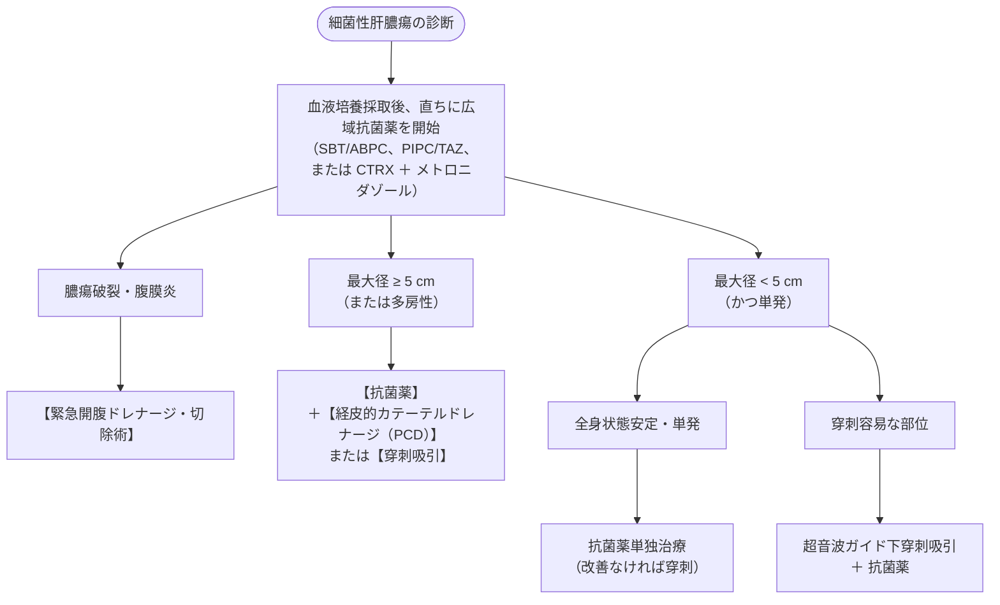

# 細菌性肝膿瘍
親カテゴリ: [[clinical-flows/D_肝・胆・膵/index|D章 肝・胆・膵]]

## 起因菌とアジアにおける特徴

- **起因菌**: **Klebsiella pneumoniae（肺炎桿菌）が約80%** を占め最多（特に糖尿病患者に好発）[cite: 299, 300]。次いで *E. coli*、レンサ球菌、嫌気性菌[cite: 299, 300]。
- **侵入経路**: 胆道系感染の波及、門脈血行性、特発性（原因不明）[cite: 299]。

> [!WARNING]- 高病原性 *K. pneumoniae*（ムコイド型）の遠隔転移性感染
> アジアに多い高病原性莢膜型（K1/K2血清型）の *K. pneumoniae* は、血行性に全身播種し**眼内炎（約3〜12%）、化膿性髄膜炎、壊死性筋膜炎** を高頻度に併発する[cite: 301, 302]。
> 視力予後が極めて不良であるため、*K. pneumoniae* 肝膿瘍を疑った際は、**眼症状がなくても直ちに眼科対診（眼底検査）** を依頼する[cite: 301, 302]。

---

## 治療アルゴリズム

### 抗菌薬治療期間
- **原則**: 経静脈投与を2〜3週間行い、解熱・CRP改善・画像上の縮小を確認後、感受性のある経口薬にスイッチして**合計4〜6週間以上**投与する[cite: 299, 300]。

> [!NOTE]- 背景悪性腫瘍の精査
> 細菌性肝膿瘍治癒後、大腸癌や肝胆道悪性腫瘍が原因門戸として潜んでいた例が多数報告されている。炎症消退後に**大腸内視鏡検査（CS）** の実施を強く推奨する[cite: 302]。

> [!NOTE]- アメーバ性肝膿瘍との鑑別
> 発展途上国渡航歴、男性同性間性的接触者（MSM）。血液培養陰性、血清アメーバ抗体陽性、PCR陽性。膿汁は無菌性チョコレート様（anchovy paste）。治療は**メトロニダゾール（750 mg 1日3回 10日間）** が著効し、ドレナージは原則不要[cite: 302, 303]。
