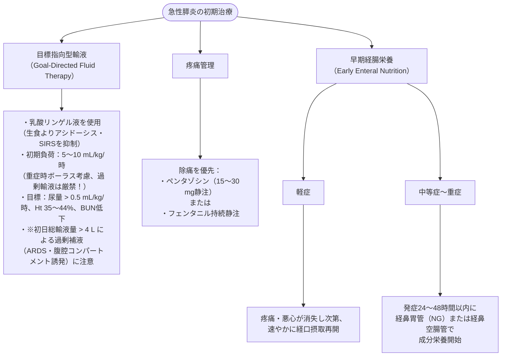
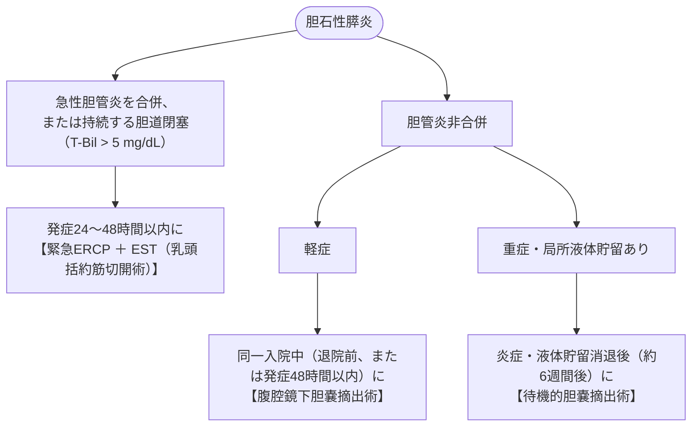

# 急性膵炎
親カテゴリ: [[clinical-flows/D_肝・胆・膵/index|D章 肝・胆・膵]]

## 診断基準と重症度判定

### 1. 診断（以下の3項目中2項目以上で確定）
1. 急性の上腹部痛・圧痛[cite: 304]
2. 血清アミラーゼまたはリパーゼが**正常上限の3倍以上**[cite: 304]
3. 腹部CT、超音波、またはMRIでの急性膵炎に合致する画像所見[cite: 304]

### 2. 重症度判定（改訂アトランタ分類 / 改訂DBC分類）
- **一過性臓器不全（48時間以内に自然軽快）**: 中等症[cite: 305, 306]。
- **持続性臓器不全（48時間以上継続）**: 重症（死亡率 40〜50%）[cite: 305, 306]。
  - 呼吸不全（$\mathrm{PaO_2/FiO_2} <300$）、循環不全（ショック、収縮期血圧 $<90\ \mathrm{mmHg}$）、腎不全（血清 $\mathrm{Cr} \ge2.0\ \mathrm{mg/dL}$）[cite: 305, 306]。

---

## 初期治療の3本柱（発症24〜48時間）

> [!WARNING]- 予防的抗菌薬投与の否定
> 壊死性膵炎であっても、感染徴候のない無菌性壊死に対する**ルーチンの予防的抗菌薬投与は予後を改善せず、耐性菌・真菌感染を増やすため推奨されない**[cite: 307, 308]。抗菌薬は感染性壊死が確認・疑われた時点で使用する[cite: 308, 309]。

---

## 局所合併症と介入戦略（Step-Up Approach）

- **感染性膵壊死 (Infected Necrosis)**:
  - 発症2〜4週以降、発熱・炎症再燃・CT上壊死巣内ガス像で疑う[cite: 309]。カルバペネム系等の膵移行性の良い抗菌薬を開始[cite: 299, 309]。
- **Step-Up Approach**:
  - ドレナージは被包化（Walled-Off Necrosis: WON）が完成する**発症4週間以降まで可能な限り延期**する（POINTER試験）[cite: 309, 310]。
  - 介入が必要な場合は、経皮的ドレナージまたは超音波内視鏡下経消化管ドレナージ（EUS-CD）から開始し、不応例に限り低侵襲的後腹膜ネクロセクトミー（壊死組織除去術）へ進む[cite: 309, 310]。

---

## 胆石性膵炎の特異的マネジメント

> [!NOTE]- 腹部コンパートメント症候群 (ACS) の監視
> 重症膵炎における過剰補液や後腹膜浮腫により腹腔内圧が急上昇する[cite: 312]。尿道カテーテルを介した膀胱内圧測定で、**腹腔内圧 $>20\ \mathrm{mmHg}$ ＋ 新たな臓器不全** を認めた場合はACSと診断し、胃管減圧、利尿・腹水穿刺、筋弛緩、外科的減圧を検討する[cite: 312]。
