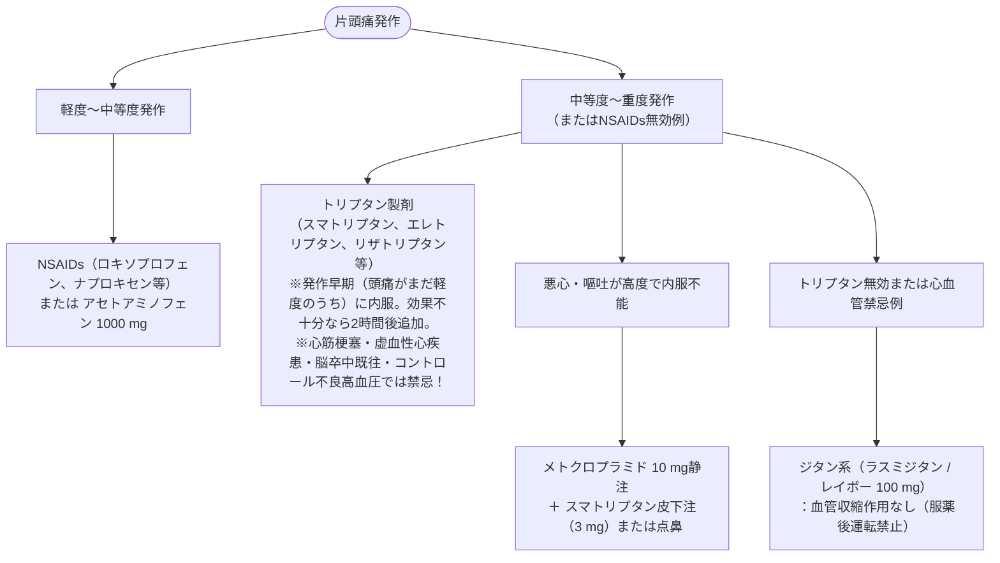

# 片頭痛
親カテゴリ: [[clinical-flows/E_神経/index|E章 神経]]

## 診断基準（ICHD-3準拠）

以下の**Pound徴候**（Pulsatile 拍動性、One-day 4〜72時間、Unilateral 片側性、Nausea 悪心・嘔吐、Disabling 日常生活困難）を満たす発作性頭痛[cite: 316, 328]。
- **前兆のない片頭痛**: 4〜72時間持続する発作が5回以上[cite: 316]。日常動作で増悪し、悪心・嘔吐または光過敏・音過敏を伴う[cite: 316]。
- **前兆のある片頭痛**: 完全可逆性の視覚症状（閃輝暗点等）、感覚障害、言語障害が5〜60分先行する発作が2回以上[cite: 316]。

---

## 急性期鎮痛治療ステップ

---

## 予防療法プロトコル

### 1. 予防薬導入の適応基準
- 発作が**月に2〜3回以上**ある、または発作により日常生活に著しい支障を来す場合[cite: 322, 324]。
- 急性期治療薬（トリプタンや鎮痛薬）の使用過多が懸念される場合[cite: 324]。

### 2. 推奨予防薬
- **第一選択経口薬**:
  - **プロプラノロール（インデラル 20〜30 mg/日）**: 若年・高血圧合併例（喘息には禁忌）[cite: 325]。※リザトリプタン併用時は血中濃度上昇のため併用禁忌[cite: 325]。
  - **アミトリプチリン（トリプタノール 10〜30 mg/日）**: 不眠・うつ傾向・緊張型頭痛混在例[cite: 325]。
  - **バルプロ酸（デパケン 400〜600 mg/日）**: てんかん合併例（催奇形性のため妊娠可能女性には回避）[cite: 325, 326]。
  - **ロメリジン（ミグシス 10〜20 mg/日）**: Ca拮抗薬。
- **抗CGRPモノクローナル抗体製剤（難治例・慢性片頭痛）**:
  - **ガルカネズマブ（エムガルティ）**: 初回240 mg皮下注 → 月1回120 mg[cite: 325]。
  - **フレマネズマブ（アジョビ）**: 4週毎225 mg または 12週毎675 mg皮下注[cite: 325]。
  - **エレヌマブ（アイモビーグ）**: 4週毎70 mg皮下注[cite: 325]。

---

## 薬物乱用頭痛 (MOH) の対応

> [!WARNING]- 鎮痛薬の頻用による悪循環
> 単剤鎮痛薬を月15日以上、またはトリプタン・複合鎮痛薬を**月10日以上、3か月を超えて連用**している慢性頭痛患者[cite: 316, 317, 326]。
> - **対応**:
>   1. 原因となっている乱用薬剤の完全中止（または段階的減量）[cite: 326]。
>   2. 離脱頭痛（withdrawal headache）に対して、早期から抗CGRP抗体製剤や経口予防薬を導入する[cite: 325, 326]。
