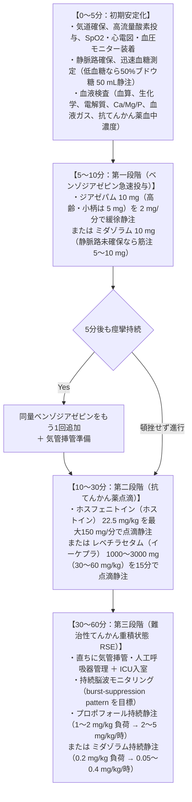

# てんかん重積の初期対応
親カテゴリ: [[clinical-flows/E_神経/index|E章 神経]]

## 初期治療プロトコル（タイムライン）

5分以上痙攣が持続する、または意識回復なく2回以上の発作を繰り返す状態[cite: 332]。

---

## 原因検索と鑑別診断

> [!NOTE]- 急性症候性発作の原因（成人・高齢者）
> 1. **中枢神経疾患**: 急性脳血管障害（脳梗塞・脳出血）、頭部外傷、脳腫瘍[cite: 335]。
> 2. **代謝・電解質異常**: 低血糖、低Na血症、高浸透圧高血糖状態 (HHS)、尿毒症、肝性脳症[cite: 335]。
> 3. **薬剤性・離脱**: アルコール離脱、ベンゾジアゼピン離脱、抗菌薬（カルバペネム、セフェム、キノロン）、三環系抗うつ薬、リチウム、テオフィリン[cite: 335]。
> 4. **中枢感染症・自己免疫**: ヘルペス脳炎、細菌性髄膜炎、自己免疫性脳炎（抗NMDA受容体抗体脳炎、抗LGI1抗体脳炎：APE²スコアで評価）[cite: 335, 336, 337]。

---

## 非痙攣性てんかん重積 (NCSE) の注意点

- 痙攣を伴わない遷延する意識障害、もうろう状態、急性認知機能低下、微細な眼球・顔面のピクつき[cite: 340]。
- ER救急搬送の意識障害患者の約5%を占める[cite: 332, 340]。原因不明の意識障害では積極的に**緊急脳波検査**を施行する[cite: 335, 340]。
