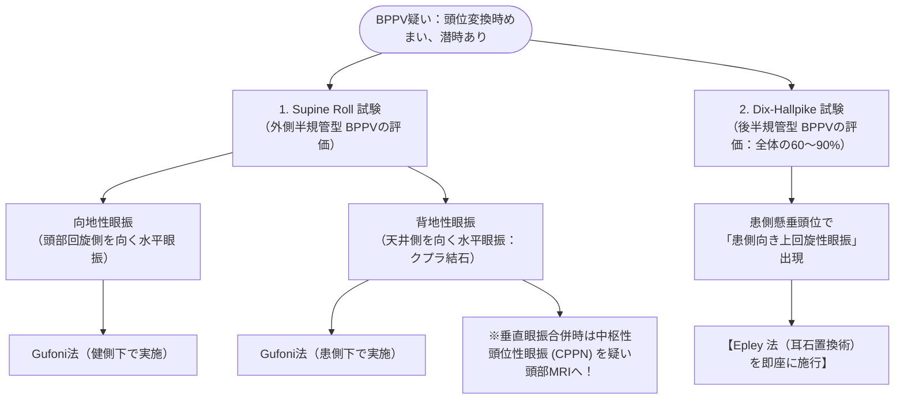

# 良性発作性頭位変換性めまい症 (BPPV)
親カテゴリ: [[clinical-flows/E_神経/index|E章 神経]]

## 臨床的特徴
頭位変換（**特に臥位になる瞬間、寝返り時**）に誘発される数十秒〜1分未満の回転性めまい[cite: 345, 346]。数秒の潜時があり、同一頭位の保持により減衰・消失する[cite: 345]。

---

## 診断・治療アルゴリズム

---

## 耳石置換法の手順

### 1. 後半規管型：Epley 法
1. 座位から頭部を患側へ45度回旋させた状態で素早く仰臥位に倒し、頭部をベッド端から20〜30度下垂させて30秒保持[cite: 346, 348, 349]。
2. 頭部を反対側（健側）へ90度回旋させ、30秒保持[cite: 348, 349]。
3. 体全体を健側側臥位へ回転させ、顔を斜め下（床側）に向けさせて30秒保持[cite: 348, 349]。
4. 頭位を保ったままゆっくり座位に戻す[cite: 348, 349]。

### 2. 外側半規管型：Gufoni 法
- 座位から健側（向地性時）または患側（背地性時）へ素早く側臥位に倒し1分保持 → 頭部を45〜60度下方（床側）または上方へ回旋させて2分保持 → 座位に戻す[cite: 348, 349]。

> [!NOTE]- 残存めまい症状 (Residual Dizziness: RD) とビタミンD
> - 耳石置換術により眼振が消失した後も、約40%の患者で数週間〜1か月程度ふらつき・浮動感が持続する[cite: 348, 350]。過度な安静を避け、通常の歩行・日常生活（ショッピングエクササイズ）を促す[cite: 350]。
> - **再発予防**: ビタミンD欠乏（$<20\ \mathrm{ng/mL}$）がある頻回再発例に対し、ビタミンD補充が再発率を有意に低下させる[cite: 350]。
