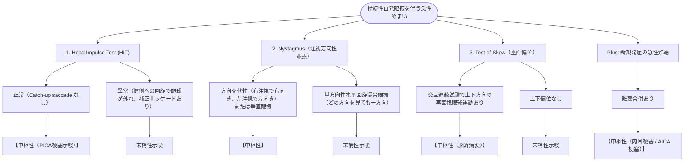

# 急性前庭症候群 (AVS) の鑑別
親カテゴリ: [[clinical-flows/E_神経/index|E章 神経]]

## 疾患概念とピットフォール
持続性の回転性めまい、自発眼振、嘔気・嘔吐、歩行障害を呈する急性症候群[cite: 352]。
- **末梢性**: 前庭神経炎（最多）、迷路炎[cite: 352, 353]。
- **中枢性**: 小脳・脳幹梗塞（**PICA梗塞、AICA梗塞**）[cite: 352, 353]。

> [!WARNING]- 早期MRIの偽陰性
> 発症48時間以内の後頭蓋窩・脳幹部ラクナ梗塞において、**拡散強調MRI (DWI) の偽陰性率は最大で約50%** に達する[cite: 352, 355, 356]。画像のみで小脳・脳幹梗塞を除外してはならず、ベッドサイドの**HINTS plus 診察**が最も鋭敏である[cite: 352, 354]。

---

## HINTS Plus アルゴリズム

以下の3検査のうち、**1つでも中枢パターン（または急性難聴）を認めれば「中枢性（脳卒中）」** と判定する（感度99%、特異度97%）[cite: 354, 355]。

> [!NOTE]- AICA（前下小脳動脈）梗塞の注意点
> AICAから内耳動脈が分岐するため、AICA梗塞では内耳壊死を伴い、**HITが末梢パターン（偽末梢所見）** を呈する[cite: 352, 353, 355]。これを拾い上げるために「指こすり試験等による急性難聴の有無」を必ず評価する（HINTS Plus）[cite: 354, 355]。
