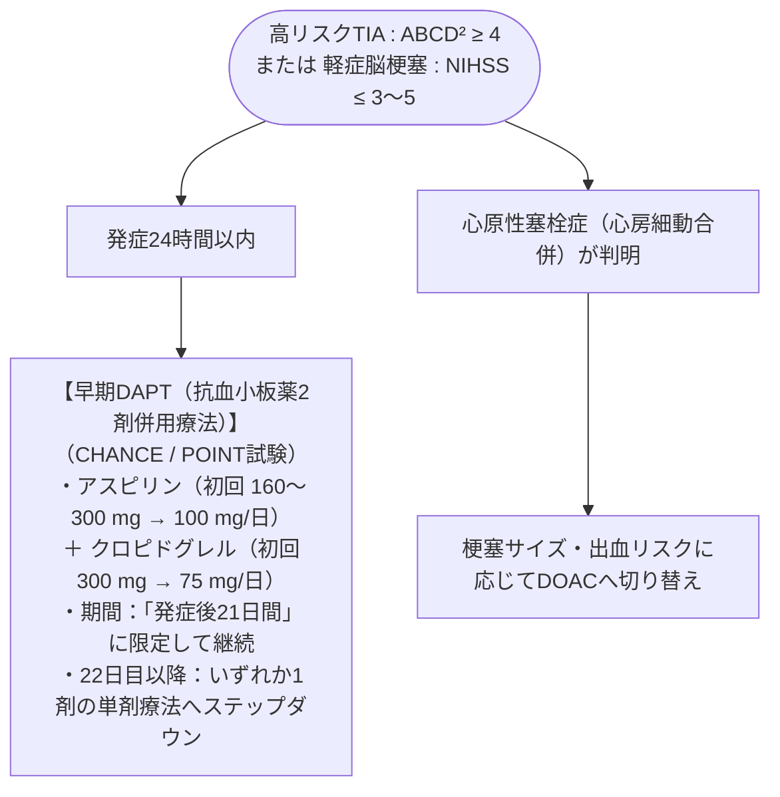

# 一過性脳虚血発作 (TIA)、軽症脳梗塞
親カテゴリ: [[clinical-flows/E_神経/index|E章 神経]]

## リスク層別化：ABCD² スコア

TIA発症後48時間以内の脳梗塞発症率は約5%、90日以内は約10%に達する[cite: 359]。

- **A**ge $\ge60$ 歳：1点[cite: 362]
- **B**lood pressure $\ge140/90\ \mathrm{mmHg}$：1点[cite: 362]
- **C**linical features: 片麻痺 (2点)、麻痺のない構音障害 (1点)[cite: 362]
- **D**uration of symptoms: $\ge60$ 分 (2点)、10〜59分 (1点)[cite: 362]
- **D**iabetes: 糖尿病あり (1点)[cite: 362]
- **判定**: **$\ge4$ 点は高リスク群**（直ちに入院精査・DAPT開始を推奨）[cite: 361, 362]。

---

## 急性期抗血栓療法プロトコル

> [!WARNING]- 21日を超える長期DAPTの回避
> 21日を超えてアスピリン＋クロピドグレルを継続しても脳梗塞予防効果の上乗せはなく、頭蓋内出血および大出血リスクのみが有意に増加する[cite: 361]。3週間の時点で必ず単剤療法へ戻す[cite: 360, 361]。

---

## TIA Mimics の除外

救急受診したTIA疑いの20〜30%は非虚血性疾患である[cite: 359]：
- **片頭痛の前兆（閃輝暗点、感覚行進）**[cite: 359]
- **部分てんかん発作後のTodd麻痺**[cite: 359]
- **低血糖発作**（必ず血糖測定！）[cite: 359]
- **末梢性前庭障害、一過性全健忘 (TGA)、機能性身体表現性障害**[cite: 359]
