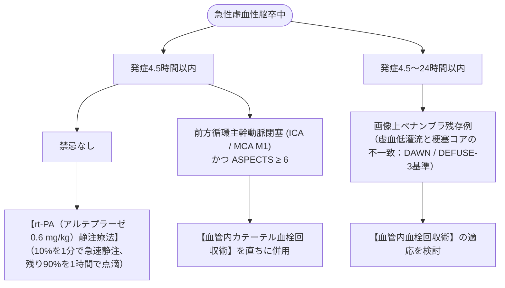

# 脳梗塞
親カテゴリ: [[clinical-flows/E_神経/index|E章 神経]]

## 超急性期再灌流療法アルゴリズム

---

## アルテプラーゼ静注の血圧管理と禁忌

### 1. 血圧管理目標
- **投与前**: 降圧薬（ニカルジピン持続静注等）を用いて **$<185/110\ \mathrm{mmHg}$** に降圧・維持[cite: 366, 368]。
- **投与後24時間**: **$<180/105\ \mathrm{mmHg}$** を厳格に維持[cite: 368]。

### 2. 主な禁忌事項
- 頭部CTで脳内出血、くも膜下出血の疑い、または広範な早期虚血変化（MCA領域の1/3超、ASPECTS $\le5$）[cite: 366, 368]。
- 3か月以内の脳梗塞・重篤な頭部外傷、21日以内の消化管出血[cite: 366, 368]。
- PT-INR $>1.7$、DOAC内服後48時間以内、血小板 $<10$ 万/$\mu\mathrm{L}$[cite: 366, 368]。
- **急性大動脈解離の合併**（胸痛・背部痛がなくても血圧左右差やDダイマー高値時は造影CTで除外）[cite: 364, 368, 375]。

---

## 病型別急性期薬物治療

| 病型 | 急性期治療 | 備考 |
| :--- | :--- | :--- |
| **アテローム血栓性 / BAD** | **アルガトロバン**（初期 60 mg/24時間持続 $\times2$ 日 → 10 mg 1日2回 $\times5$ 日） ＋ **アスピリン**[cite: 366, 367] | 進行・再増悪予防[cite: 367]。 |
| **ラクナ梗塞** | **抗血小板療法**（アスピリン 100〜200 mg/日、シロスタゾール 200 mg/日等）[cite: 367] | 脱水補正を徹底[cite: 366]。 |
| **心原性脳塞栓症** | **抗凝固療法（DOAC / ワルファリン）**[cite: 367] | 導入時期は「1-3-6-12日ルール」または早期開始[cite: 367, 368]。 |

> [!NOTE]- 心房細動に伴う抗凝固薬の再開時期（1-3-6-12日ルール）
> - **TIA**: 発症**1日後**（翌日）に導入[cite: 367, 368]。
> - **小梗塞 (NIHSS <8)**: 発症**3日後**に導入[cite: 367, 368]。
> - **中等度梗塞 (NIHSS 8〜15)**: 発症**6日後**に出血性梗塞がないことをCT/MRIで確認して導入[cite: 367, 368]。
> - **大梗塞 (NIHSS $\ge16$)**: 出血転化リスクが高いため、発症**12〜14日後**まで延期[cite: 367, 368]。
