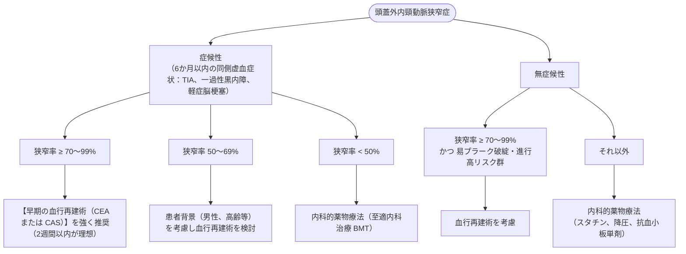

# 頸動脈狭窄 (頭蓋外)
親カテゴリ: [[clinical-flows/E_神経/index|E章 神経]]

## 治療適応の判断基準

---

## 外科治療の選択：CEA vs CAS

- **頸動脈内膜剥離術 (CEA)**:
  - 標準的術式[cite: 381]。70歳以上の高齢者や解剖学的屈曲の強い血管ではCASより周術期脳卒中リスクが低く推奨される[cite: 381]。
- **頸動脈ステント留置術 (CAS)**:
  - CEA高リスク群（重篤な心肺合併症、高位病変 C2以上、放射線照射後頸部、再狭窄例、対側頸動脈閉塞）における第一選択[cite: 381]。

---

## 至適内科治療 (Best Medical Therapy: BMT)

1. **抗血小板療法**:
   - 症候性急性期：アスピリン＋クロピドグレルのDAPT（21日〜3か月間）→ 以後単剤継続[cite: 380, 381]。
   - 無症候性：アスピリン単剤またはクロピドグレル単剤[cite: 380]。
2. **強力な脂質低下療法**:
   - 高強度スタチンにより **LDL-C $<70\ \mathrm{mg/dL}$**（またはベースラインから50%以上低下）を達成し、プラークの安定化・退縮を図る[cite: 380]。
3. **厳格な血圧・血糖管理**: 目標血圧 $<130〜140/80〜90\ \mathrm{mmHg}$、禁煙指導徹底[cite: 380]。
