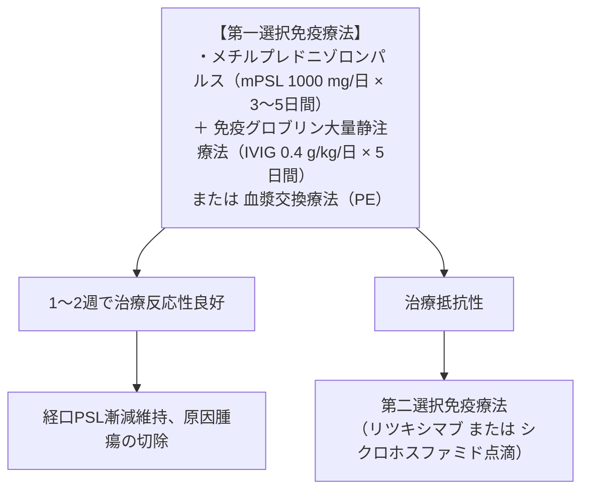

# 自己免疫性脳炎
親カテゴリ: [[clinical-flows/E_神経/index|E章 神経]]

## 疾患概念と2大病態

1. **細胞表面受容体抗体（シナプス抗原：抗NMDA-R、抗LGI1、抗CASPR2等）**:
   - 抗体が直接受容体機能を修飾。**免疫療法（ステロイド、IVIG、血漿交換）への反応性が良好**[cite: 387, 389]。腫瘍随伴率は低〜中等度（奇形腫や胸腺腫など）[cite: 387, 389]。
2. **細胞内抗原抗体（Onconeural抗原：抗Hu/ANNA-1、抗Yo、抗Ma2等）**:
   - 細胞傷害性T細胞による神経細胞破壊が主体。**悪性腫瘍（小細胞肺癌等）の随伴率が極めて高く（>90%）、免疫療法抵抗性**[cite: 387, 389]。原発巣の外科切除が必須[cite: 387, 390]。

---

## 臨床的特徴と抗体スペクトラム

- **抗NMDA受容体脳炎**:
  - 若年女性に好発。前駆感染様症状 → 精神症状・幻覚・奇異行動 → 難治性痙攣・不随意運動（口唇ジスキネジア） → 低換気・自律神経不全[cite: 387]。**卵巣奇形腫**の合併が多く骨盤MRIが必須[cite: 387, 389]。
- **抗LGI1抗体脳炎**:
  - 高齢男性に好発。辺縁系脳炎（短期記憶障害）、**顔面上腕ジストニア発作 (FBDS：一日に数十回生じるピクつき)**、難治性低Na血症[cite: 387, 389]。

---

## 治療プロトコル

> [!WARNING]- 抗体結果を待たずに治療を開始する
> 自己抗体測定には数週間を要するため、臨床診断基準（急性辺縁系脳炎、APE²スコア $\ge4$）を満たし感染性脳炎が否定された場合は、**抗体結果を待たずに直ちに初期免疫療法を開始**する[cite: 388, 390]。

