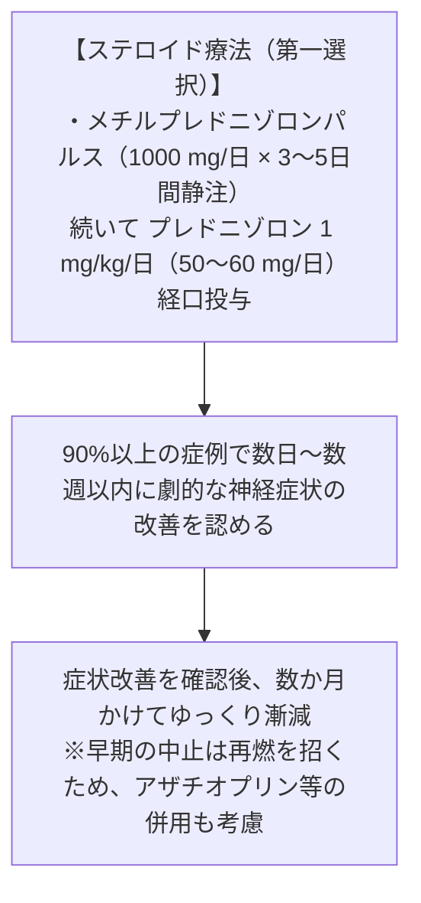

# 橋本脳症 (SREAT)
親カテゴリ: [[clinical-flows/E_神経/index|E章 神経]]

## 疾患概念
自己免疫性甲状腺炎（橋本病）患者に合併するステロイド反応性脳症（Steroid-Responsive Encephalopathy Associated with Autoimmune Thyroiditis: SREAT）[cite: 395]。甲状腺ホルモン機能異常そのものではなく、自己免疫機序が本態[cite: 395]。

---

## 臨床病型と特徴

- **好発**: 40〜50歳代の女性に多い（男:女 = 1:4）[cite: 395]。
- **病型**:
  1. **急性脳症型 (約60%)**: 急激な意識障害、けいれん重積、ミオクローヌス、卒中様エピソード[cite: 395]。
  2. **慢性精神病・認知症型 (約20%)**: 緩徐進行性の認知機能低下、幻覚、妄想、うつ状態[cite: 395]。
  3. **進行性小脳失調型 (約15%)**[cite: 395]。

---

## 診断基準

1. 精神症状、意識障害、認知障害、てんかん発作、運動失調を伴う急性〜亜急性の脳症[cite: 395]。
2. **抗TPO抗体または抗サイログロブリン (TG) 抗体の高力価陽性**[cite: 395]。
   - ※**甲状腺機能（TSH, FT4）は70〜80%で正常**である点に注意[cite: 395]。
3. 感染症、代謝異常、中毒、脳血管障害の完全な除外[cite: 395]。
4. **ステロイド治療に対する速やかな反応性**（治療的診断）[cite: 395]。
   - 特異的マーカーとして血清・髄液の抗NAE（α-エノラーゼN末端）抗体がある（感度約50%、特異度約90%）[cite: 395]。

---

## 治療プロトコル

