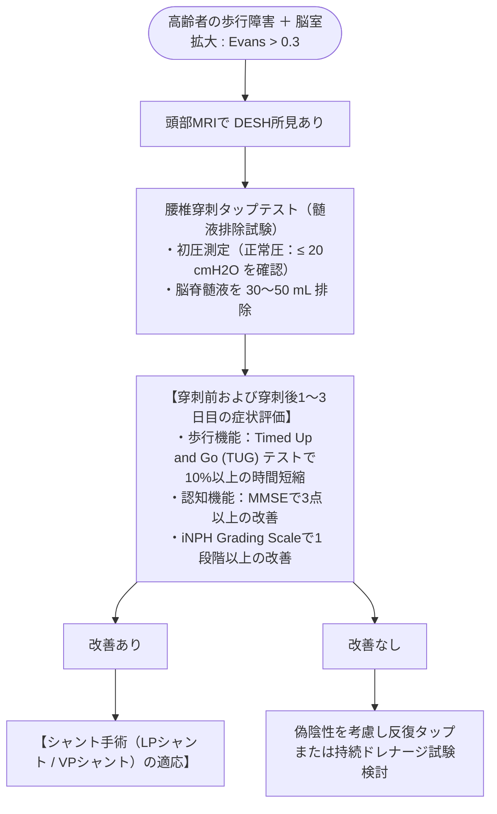

# 特発性正常圧水頭症 (iNPH)
親カテゴリ: [[clinical-flows/E_神経/index|E章 神経]]

## 臨床3徴
60歳以降に緩徐進行性に発症する[cite: 397, 402]：
1. **歩行障害（最重要・初発徴候）**: 小刻み歩行、すり足、開脚歩行（Wide-based）、方向転換時の不安定性・多歩数[cite: 397, 398, 402]。
2. **認知機能障害**: 前頭葉・皮質下性（自発性低下、精神運動緩慢、注意障害）[cite: 397, 398, 402]。
3. **排尿障害**: 頻尿、切迫性尿失禁[cite: 397, 398, 402]。

---

## 画像診断：DESH (Disproportionately Enlarged Subarachnoid-space Hydrocephalus)

> [!NOTE]- iNPH に特異的な頭部MRI所見（冠状断で確認）
> 1. **側脳室の拡大**: **Evans index $>0.30$**（前角最大幅 / 頭蓋内板最大幅）[cite: 397, 398]。
> 2. **Sylvius裂・脳底槽の著明な開大**[cite: 398, 402]。
> 3. **高位円蓋部・大脳正中部の脳溝・くも膜下腔の狭小化（Tight high convexity）**[cite: 398, 402]。
> 4. **脳室周囲白質病変（PVH）**[cite: 398, 399]。

---

## 診断とタップテスト (Tap Test) フロー

> [!NOTE]- シャント術の選択
> 日本国内では侵襲が少なく開頭を要さない**腰髄腹腔シャント術 (LPシャント)** が広く普及しており、脳室腹腔シャント術 (VPシャント) と同等の長期改善率が証明されている（SINPHONI-2試験）[cite: 401]。
