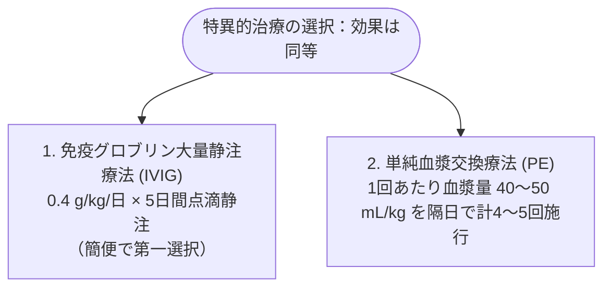

# Guillain-Barré 症候群 (GBS)
親カテゴリ: [[clinical-flows/E_神経/index|E章 神経]]

## 臨床症状と経過
- **前駆感染**: 発症1〜3週間前に感染症（*Campylobacter jejuni*, CMV, EBV, 呼吸器感染症）が約2/3に存在[cite: 403, 405]。
- **神経症候**:
  - 先行する**四肢・腰背部の疼痛・しびれ**[cite: 404]。
  - **左右対称性の上行性弛緩性麻痺**（下肢から始まり上肢へ進行）[cite: 404, 406]。
  - **深部腱反射の減弱〜消失**[cite: 403, 406]。
  - **進行のピーク**: 12時間〜4週間以内（4週を超えて進行する場合はCIDPを疑う）[cite: 404, 406]。

---

## 亜型と抗ガングリオシド抗体

- **AIDP（脱髄型）**: 欧米に多い。腱反射消失、感覚障害併発[cite: 403]。
- **AMAN（軸索型）**: アジア・日本に多い（約65%）。運動障害主体。**抗GM1抗体、抗GD1a抗体陽性**[cite: 403, 407]。
- **Miller Fisher 症候群 (MFS)**:
  - 臨床3徴：**外眼筋麻痺（複視）＋ 運動失調 ＋ 深部腱反射消失**[cite: 403, 406]。
  - **抗GQ1b抗体陽性（感度80〜90%以上）**[cite: 403, 407]。

---

## 重症呼吸不全・自律神経不全の監視

> [!WARNING]- 予防的気管挿管の基準（20/30/40ルール）
> 呼吸筋麻痺の進行による突然の呼吸停止を防ぐため、以下を認めた場合は速やかに人工呼吸管理へ移行する[cite: 407]：
> - **肺活量 (FVC) $<20\ \mathrm{mL/kg}$**（または予測値の50%以下）[cite: 407]
> - **最大吸気圧 $<30\ \mathrm{cmH_2O}$**[cite: 407]
> - **最大呼気圧 $<40\ \mathrm{cmH_2O}$**[cite: 407]
> - 頸部筋力低下（首を持ち上げられない）、喀痰喀出困難、単語でしか話せない[cite: 407]。
> - **自律神経障害**: 著明な不整脈（洞停止、心室頻拍）、起立性低血圧、高血圧サージの監視[cite: 407, 408]。

---

## 治療プロトコル

発症早期（できれば2週間以内）、自力歩行不能例（GBS disability scale $\ge3$）で開始する[cite: 408]。
```markdown

> [!WARNING]- 禁忌事項
> **副腎皮質ステロイド単独投与は無効であり、むしろ回復を遅延させるため禁忌**である[cite: 408]。また、IVIGと血漿交換の併用は上乗せ効果がなく行わない[cite: 408]。
