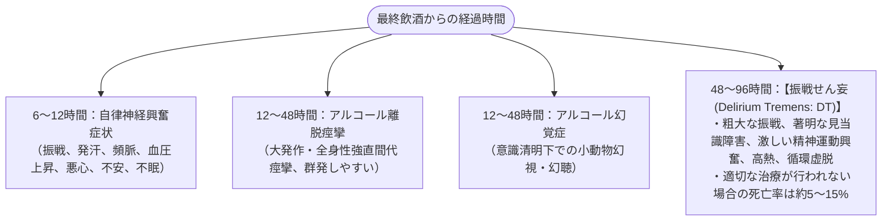

# アルコール離脱症候群
親カテゴリ: [[clinical-flows/E_神経/index|E章 神経]]

## 症候のタイムライン

---

## 重症度評価：CIWA-Ar スコア

悪心(0-7), 振戦(0-7), 発汗(0-7), 不安(0-7), 興奮(0-7), 触覚異常(0-7), 聴覚異常(0-7), 視覚異常(0-7), 頭痛(0-7), 見当識障害(0-4) の10項目（合計67点）[cite: 419]：
- **$<8$ 点**: 軽度（支持療法・経過観察のみで可）[cite: 415, 417]。
- **8〜15点**: 中等度（薬物介入を推奨）[cite: 415]。
- **$\ge16$ 点**: 重度（積極的ベンゾジアゼピン急速飽和療法が必要）[cite: 415]。

---

## 治療プロトコル

### 1. ベンゾジアゼピン投与戦略
- **Symptom-Triggered Therapy（症状連動投与）**:
  - 定時投与よりもベンゾジアゼピン総投与量と入院期間を有意に削減可能[cite: 417]。
  - CIWA-Ar $\ge8〜10$ 点、またはバイタルサイン異常時（HR $>100$、BP $>150/90$）に、**ジアゼパム 5〜10 mg 経口（または静注）** を1〜2時間毎に投与し、鎮静（RASS 0〜-1目標）が得られるまで反復する[cite: 415, 416, 417]。
- **難治性振戦せん妄**:
  - 大量ジアゼパム（$>50\ \mathrm{mg/hr}$）抵抗例には、フェノバルビタール静注、またはプロポフォール/デクスメデトミジンによるICU鎮静管理[cite: 415, 416, 417]。

### 2. 必須のビタミン・電解質補正

> [!WARNING]- Wernicke脳症の予防（ブドウ糖投与前のチアミン）
> 慢性アルコール多飲者ではチアミン（ビタミンB1）が著明に欠乏している[cite: 415, 416, 420]。チアミン未投与の状態でブドウ糖輸液を行うと、急激にチアミンが消費されて致死的な**Wernicke脳症（外眼筋麻痺、運動失調、意識障害）** を不可逆的に発症する[cite: 416, 420]。
> **いかなるブドウ糖輸液よりも前に、ビタミンB1（チアミン 200〜500 mg 静注）を先行投与**すること[cite: 416]。低マグネシウム血症・低カリウム血症も同時に補正する[cite: 415]。
