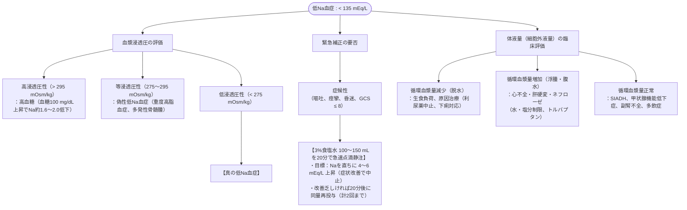

# 電解質：ナトリウム濃度の異常
親カテゴリ: [[clinical-flows/F_腎・泌尿器/index|F章 腎・泌尿器]]

## 低Na血症の診断・補正アルゴリズム

血清Na濃度は水との相対的バランス（$[Na] = (Na_e + K_e) / TBW$）で規定される[cite: 422]。

> [!WARNING]- 補正速度の限界と浸透圧性脱髄症候群 (ODS)
> 慢性低Na血症（>48時間経過または不明）を急激に補正すると橋中心髄鞘崩壊症（ODS）を惹起する[cite: 422, 424]。
> - **24時間の補正上限**: **$\le8\ \mathrm{mEq/L}$**（ODS高リスク群：血清Na $\le105\ \mathrm{mEq/L}$、低K血症、低栄養、アルコール中毒、高度肝障害では **$\le4\sim6\ \mathrm{mEq/L/24h}$**）[cite: 422, 424]。
> - **過補正時**: 尿量が急増してNa補正速度が上限を超えそうな場合は、直ちに5%ブドウ糖液投与やデスモプレシン（1〜2 µg静注）を併用して上昇をブレーキする[cite: 424, 425, 427]。

---

## SIADH の診断基準と鑑別

1. 低浸透圧性低Na血症（血漿浸透圧 $<275\ \mathrm{mOsm/kg}$）[cite: 429]
2. 不適切な尿濃縮（**尿浸透圧 $>100\ \mathrm{mOsm/kg}$**）[cite: 426, 429]
3. 尿中Na排泄の持続（**尿中Na $>30\ \mathrm{mEq/L}$**、正常塩分・水分摂取下）[cite: 426, 429]
4. 臨床的循環血漿量正常（脱水・浮腫なし）[cite: 426, 429]
5. **副腎皮質機能・甲状腺機能・腎機能が正常**[cite: 426, 429]
6. ※利尿薬使用中での判定：**尿酸排泄分画（$\mathrm{FE_{UA}} >12\%$）** がSIADH合致所見[cite: 426, 427, 430]。

---

## 高Na血症 (>145 mEq/L) の補正

水欠乏（水分の相対的喪失）が本態[cite: 422]。

- **補正速度**: 慢性例では **0.3〜0.5 mEq/L/時（$\le10\ \mathrm{mEq/L/24h}$）** を厳守（急速な補正は脳浮腫を招く）[cite: 431]。
- **必要水分欠乏量 (Free Water Deficit)**:
  $$\text{欠乏水分量 (L)} = \text{TBW} \times \left( \frac{\text{実測Na}}{140} - 1 \right)$$
  ※TBW（体重 $\times 0.6$ [男性] または $0.5$ [女性]）[cite: 425]。5%ブドウ糖液を用いて計算量を24〜48時間かけて補充[cite: 430, 431]。
