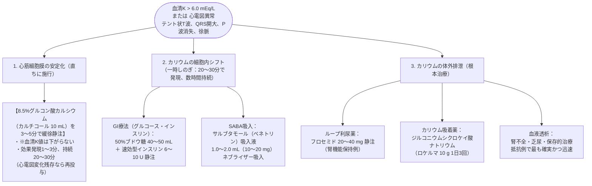

# 電解質：カリウム濃度の異常
親カテゴリ: [[clinical-flows/F_腎・泌尿器/index|F章 腎・泌尿器]]

## 高K血症 (>5.0 mEq/L) の緊急治療

致死的不整脈（心室細動・心静止）を予防・解除する[cite: 432, 434]。

---

## 低K血症 (<3.5 mEq/L) の評価と安全な補正

### 1. 腎排泄か否かの評価
- **随時尿中 K/Cr 比**:
  - $<18\sim22\ \mathrm{mEq/g\ Cr}$: 腎外性喪失（下痢、多汗、摂取不足、細胞内シフト）[cite: 433, 434]。
  - $>18\sim22\ \mathrm{mEq/g\ Cr}$: 腎性喪失（利尿薬、原発性アルドステロン症、Cushing症候群、RTA）[cite: 433, 434]。

### 2. 補正プロトコルと投与制限

> [!WARNING]- カリウム急速静注の厳重注意
> - **末梢静脈からの投与**: 血管痛・静脈炎防止のため **濃度 $\le40\ \mathrm{mEq/L}$**、**投与速度 $\le20\ \mathrm{mEq/h}$** を厳守[cite: 434, 436]。原液静注は心停止を惹起するため絶対禁忌。
> - **重症致死的不整脈時（中心静脈投与）**: 心電図モニター監視下で、20 mEq/100 mL（生食）を中心静脈から1時間で投与[cite: 434, 435]。
> - **低Mg血症の同時補正**: 低Mg血症が併存すると尿中K排泄が亢進しK値が是正されない。必ず血清Mgを測定し、同時に補正する[cite: 434, 435]。
