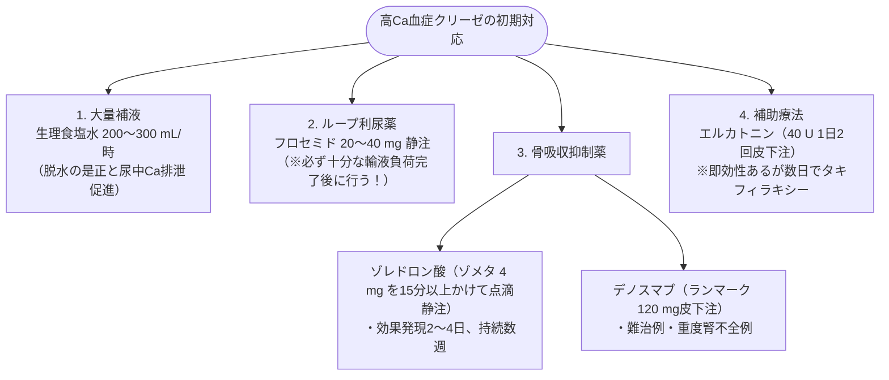

# 電解質：カルシウム濃度の異常
親カテゴリ: [[clinical-flows/F_腎・泌尿器/index|F章 腎・泌尿器]]

## 補正カルシウム濃度計算式
血清アルブミン $<4.0\ \mathrm{g/dL}$ の低アルブミン血症では見かけ上低下するため補正する[cite: 441]：
$$\text{補正Ca (mg/dL)} = \text{実測Ca} + 0.8 \times (4.0 - \text{Alb})$$[cite: 441]

---

## 高カルシウム血症 (補正Ca >10.5 mg/dL) のマネジメント

原因の90%は**原発性副甲状腺機能亢進症 (PHPT)** と **悪性腫瘍に伴う高Ca血症 (MAH)**[cite: 444, 446]。

### 1. 診断鑑別ステップ
- **intact PTH測定**:
  - **PTH 正常〜高値**: 原発性副甲状腺機能亢進症、三半規管疾患、リチウム内服、家族性低カルシュウム尿性高Ca血症 (FHH：24時間尿中Ca/Cr比 $\le0.01$)[cite: 445]。
  - **PTH 低値 ($<20\ \mathrm{pg/mL}$)**: PTHrP（悪性腫瘍：扁平上皮癌、ATL等）、1,25(OH)2D上昇（サルコイドーシス、悪性リンパ腫）、ビタミンD中毒、多発性骨髄腫[cite: 445, 446]。

### 2. 急性期治療（症候性または補正Ca >14.0 mg/dL）

---

## 低カルシウム血症 (補正Ca <8.5 mg/dL) のマネジメント

- **急性期症候性（テタニー、喉頭痙攣、不整脈、QT延長、Chvostek/Trousseau徴候陽性）**:
  - **8.5%グルコン酸カルシウム（カルチコール）10〜20 mL を10〜20分で緩徐に静注**[cite: 442]。
  - 続いて 0.5〜1.5 mg/kg/時で維持点滴[cite: 442]。
- **慢性期**: 活性型ビタミンD3製剤（アルファカルシドール、カルシトリオール）＋ 炭酸カルシウム経口投与[cite: 444]。
