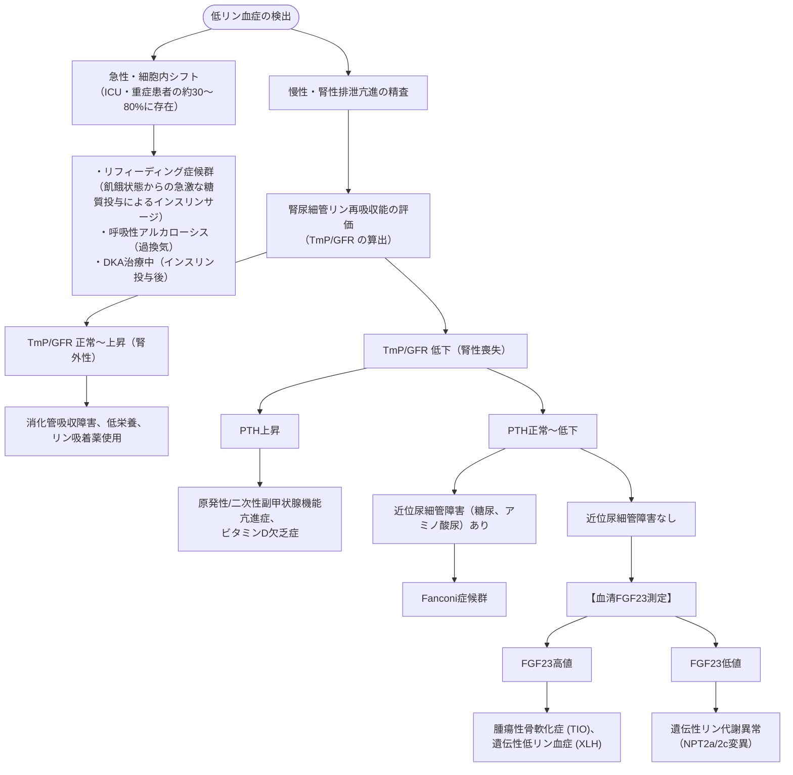

# 電解質：リン濃度の異常
親カテゴリ: [[clinical-flows/F_腎・泌尿器/index|F章 腎・泌尿器]]

## 低リン血症 (<2.5 mg/dL) の鑑別とアセスメント

---

## 治療プロトコル

### 1. 低リン血症の補正
- **重症（$<1.0\ \mathrm{mg/dL}$ または 呼吸不全・心不全合併）**:
  - **リン酸二カリウム（10〜20 mmol を生食または5%糖液 500 mLに混和）を0.2〜0.4 mmol/kg で6時間以上かけて点滴静注**[cite: 453]。
  - ※高K血症の併発に厳重警戒（K濃度算定必須）[cite: 453]。
- **中等症（$1.0\sim2.0\ \mathrm{mg/dL}$）**: ホスリボン配合顆粒等の経口補充[cite: 453]。

### 2. 高リン血症 (>4.5 mg/dL) の管理
- **主原因**: 進行期CKD・末期腎不全（G4〜G5）、腫瘍崩壊症候群 (TLS)、横紋筋融解症[cite: 449, 452]。
- **治療**:
  - 食事リン制限（$<800\sim1000\ \mathrm{mg/day}$）[cite: 470]。
  - **リン吸着薬**: 炭酸カルシウム（低Ca合併時）、炭酸ランタン、セベラマー、スクロオキシ水酸化鉄（ピートル）[cite: 453, 470]。
  - 急性重症例（TLS等）：大量補液、血液透析[cite: 452, 453]。
