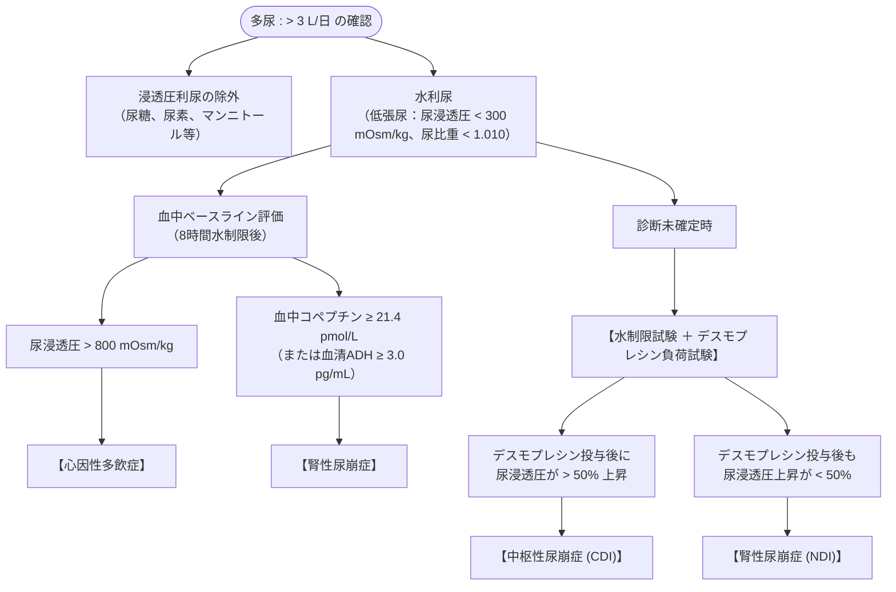

# 尿崩症
親カテゴリ: [[clinical-flows/F_腎・泌尿器/index|F章 腎・泌尿器]]

## 疾患概念と診断基準
多飲、多尿（**成人で $>40\sim50\ \mathrm{mL/kg/day}$、または $>3\ \mathrm{L/day}$**）を呈し、腎での水再吸収が破綻する疾患群[cite: 459]。

---

## 多尿の鑑別アルゴリズム

---

## 中枢性 vs 腎性のマネジメント

### 1. 中枢性尿崩症 (CDI)
- **原因**: 特発性、頭部外傷・脳外科術後、頭蓋咽頭腫・胚細胞腫、下垂体炎、サルコイドーシス[cite: 465]。頭部MRIで**下垂体後葉の高信号（T1WI bright spot）が消失**する[cite: 462, 465]。
- **治療**:
  - **デスモプレシン（ミニリンメルトOD錠 60〜120 µg 1日2〜3回、または点鼻スプレー）**[cite: 464]。
  - ※過剰投与による水中毒・低Na血症に注意。

### 2. 腎性尿崩症 (NDI)
- **原因**:
  - 薬剤性（**炭酸リチウムが最多**、アムホテリシンB、ホスカルネット）[cite: 463, 464]。
  - 電解質異常（**高Ca血症、低K血症**）、尿路閉塞解除後[cite: 459, 464]。
- **治療**:
  - 原因薬剤の中止、電解質補正[cite: 464, 465]。
  - **サイアザイド系利尿薬（ヒドロクロロチアジド 25〜50 mg/日）** ＋ 塩分制限（近位尿細管での代償性水再吸収を促進）[cite: 464, 465]。
