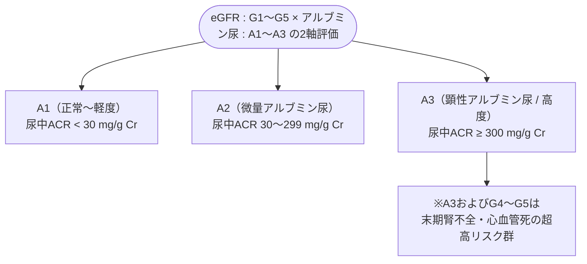

# 慢性腎臓病のマネジメント
親カテゴリ: [[clinical-flows/F_腎・泌尿器/index|F章 腎・泌尿器]]

## 定義と重症度分類（CGA分類）

腎障害を示唆する所見（蛋白尿・アルブミン尿）または **eGFR $<60\ \mathrm{mL/min/1.73m^2}$ が3か月以上持続**する状態[cite: 466]。

---

## 腎機能悪化・心血管イベント抑制の治療プロトコル

### 1. 血圧管理とRAAS阻害薬
- **目標血圧**: **$<130/80\ \mathrm{mmHg}$**（微量〜顕性アルブミン尿合併例）[cite: 468]。
- **薬剤選択**:
  - 尿中アルブミン $\ge30\ \mathrm{mg/g\ Cr}$（糖尿病・非糖尿病例ともに）では、**ACE阻害薬またはARBを第一選択**とする[cite: 467, 468]。
  - ※投与開始後2週で血清Cr・カリウムを測定。Cr上昇が基礎値の30%以内なら継続[cite: 468, 474]。**ACE-IとARBの併用は急性腎障害・高K血症を増やすため禁忌**[cite: 468]。

### 2. SGLT2阻害薬
- **ダパグリフロジン（フォシーガ 10 mg/日）**:
  - 糖尿病の有無に関わらず、CKD（eGFR 25〜75、尿中ACR 200〜5000）において末期腎不全進行・死亡率を有意に抑制（DAPA-CKD試験）[cite: 468, 494]。
### 3. アシドーシス補正
- 血清 $\mathrm{HCO_3^-} <22\ \mathrm{mEq/L}$ では、**炭酸水素ナトリウム（重曹 1〜3 g/日）** を内服投与し、腎機能低下を遅延させる（UBI試験）[cite: 469]。

---

## 腎不全合併症の管理基準

1. **腎性貧血**:
   - 介入基準: **Hb $<10.0\ \mathrm{g/dL}$**（目標値 **$11.0\sim12.0\ \mathrm{g/dL}$**、Hb $>13.0$ を超える過剰補正は脳卒中・血栓症リスク増大）[cite: 471, 472]。
   - 鉄欠乏の補正（フェリチン $<100\ \mu\mathrm{g/L}$ または TSAT $<20\%$ なら鉄剤先行）[cite: 472]。
   - **エリスロポエチン製剤 (ESA: ダルベポエチン等)** または **HIF-PH阻害薬（ロキサデュスタット等）** の投与[cite: 470, 471]。
2. **CKD-MBD（骨代謝異常）**:
   - G3b以降で血清Ca、リン、intact PTHを定期測定[cite: 469, 470]。
   - 血清リン $>4.5\ \mathrm{mg/dL}$ ではリン制限食＋非カルシウム系リン吸着薬（炭酸ランタン、ピートル、セベラマー）[cite: 470]。
