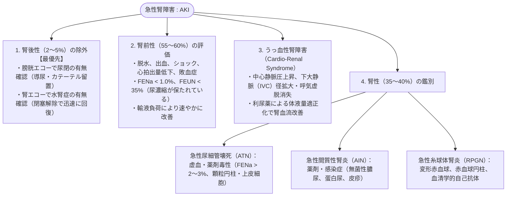

# 急性腎障害のアセスメント
親カテゴリ: [[clinical-flows/F_腎・泌尿器/index|F章 腎・泌尿器]]

## 診断基準（KDIGO 基準）

以下のいずれかを満たす場合に急性腎障害 (AKI) と診断する[cite: 477]：
1. **48時間以内に血清Crが $\ge0.3\ \mathrm{mg/dL}$ 上昇**[cite: 477]
2. **7日以内に血清Crがベースラインの $\ge1.5$ 倍に上昇**[cite: 477]
3. **尿量 $<0.5\ \mathrm{mL/kg/h}$ が6時間以上持続**[cite: 477]

---

## AKI の4大病態評価フロー

---

## 急性血液浄化療法（透析）の緊急適応

> [!WARNING]- AIEOU ルール（直ちに透析を導入すべき徴候）
> - **A (Acidosis)**: 治療抵抗性の高度代謝性アシドーシス（$\mathrm{pH} < 7.15$）[cite: 479, 480]
> - **I (Intoxication)**: 透析性薬物中毒（リチウム、アスピリン、エチレングリコール等）
> - **E (Electrolytes)**: 難治性高カリウム血症（$[K^+] > 6.5\ \mathrm{mEq/L}$、心電図異常）[cite: 479, 480]
> - **O (Overload)**: 利尿薬不応性の急性肺水腫・体液過剰[cite: 479, 480]
> - **U (Uremia)**: 尿毒症症状（心膜炎、脳症、出血傾向、高度消化器症状）[cite: 479]
