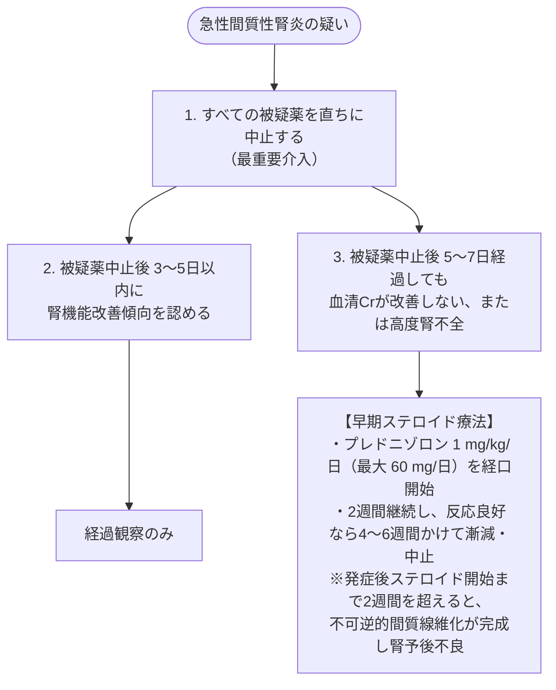

# 急性間質性腎炎
親カテゴリ: [[clinical-flows/F_腎・泌尿器/index|F章 腎・泌尿器]]

## 疾患特性と3大起因薬

急性腎障害の約15〜27%を占める炎症性病態[cite: 482]。**原因の75%以上が薬剤性**（免疫学的過敏反応）である[cite: 482, 484]。

> [!NOTE]- 薬剤性急性間質性腎炎 (AIN) の代表的原因
> 1. **抗菌薬（最多）**: β-ラクタム系、セフェム系、ST合剤、バンコマイシン、リファンピシン[cite: 484, 485]。
> 2. **プロトンポンプ阻害薬 (PPI)**: オメプラゾール、ランソプラゾール等（高齢者に多発、数か月の潜行性発症あり）[cite: 484, 485]。
> 3. **NSAIDs**: 服用後数か月〜1年以上でも発症。しばしばネフローゼ域蛋白尿を伴う[cite: 482, 483, 485]。
> 4. **免疫チェックポイント阻害薬 (ICI)**: ニボルマブ、ペムブロリズマブ等[cite: 484, 485]。

---

## 臨床像とピットフォール

- 古典的3徴（発熱、皮疹、好酸球増多）が**すべて揃う症例は10〜15%程度にすぎない**[cite: 482]。
- **尿所見**: 軽度蛋白尿（$<1\ \mathrm{g/day}$）、顕微鏡的血尿、無菌性膿尿、白血球円柱[cite: 482, 483]。**腎性尿糖（血糖正常なのに尿糖陽性）** は尿細管間質障害を疑う重要徴候[cite: 483]。
- ※尿中好酸球検査は感度・特異度ともに低く、除外診断には役立たない[cite: 483]。

---

## 治療プロトコル

