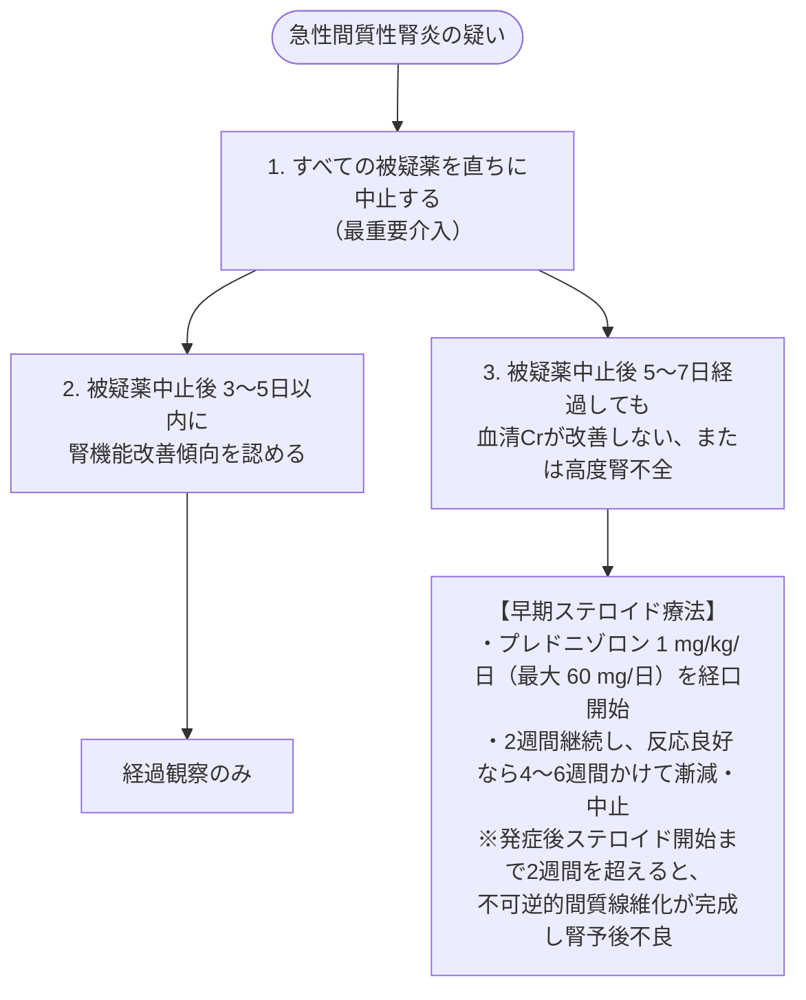

# IgA 腎症
親カテゴリ: [[clinical-flows/F_腎・泌尿器/index|F章 腎・泌尿器]]

## 臨床症候と受診契機
日本における慢性糸球体腎炎の約30〜40%を占める最多疾患[cite: 491]。
- **無症候性検尿異常 (約70%)**: 学校・職域健診での持続的顕微鏡的血尿 ＋ 蛋白尿[cite: 491]。
- **肉眼的血尿 (約10〜15%)**: **上気道炎（感冒・扁桃炎）発症後24〜48時間以内**に急速に出現する茶褐色〜肉眼的血尿（急性咽頭炎後1〜2週あけて生じる溶連菌感染後腎炎との鑑別点）[cite: 491]。

---

## 治療アルゴリズム（KDIGO 2021 / 国内ガイドライン）

> [!NOTE]- 扁桃摘出術＋ステロイドパルスの位置づけ
> 口蓋扁桃は異常糖鎖欠損IgA1の主要産生部位と考えられている[cite: 494]。国内ガイドラインでは、活動性病変を有し尿蛋白が持続する症例に対し、**扁摘パルス療法**が長期的な臨床的寛解（血尿・蛋白尿消失）および腎不全移行抑制をもたらす有効な治療選択肢として推奨されている[cite: 492, 494]。
