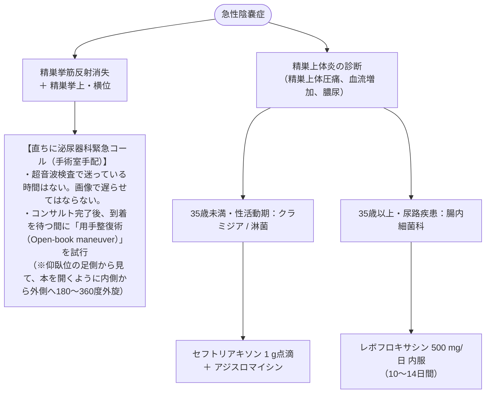

# 急性陰嚢症：精巣捻転と精巣上体炎
親カテゴリ: [[clinical-flows/F_腎・泌尿器/index|F章 腎・泌尿器]]

## 精巣捻転を見逃さないための鑑別

急激な陰嚢部痛・下腹部痛を診た際、**最優先で除外すべきは「精巣捻転（睾丸回転）」** である[cite: 505]。
- **タイムリミット**: **発症から6〜8時間以内**に捻転を解除・整復しなければ、精巣壊死・妊孕性喪失に至る（6時間以内救命率90%、24時間後10%）[cite: 505, 506]。

---

## 臨床所見の対比

| 評価項目 | 精巣捻転 (Testicular Torsion) | 急性精巣上体炎 (Epididymitis) |
| :--- | :--- | :--- |
| **発症様式** | **突然の激痛（分単位、睡眠中・早朝好発）**[cite: 505, 506] | 比較的緩徐〜亜急性の増悪（数時間〜数日）[cite: 505] |
| **好発年齢** | 12〜18歳思春期（小児〜青年期最多）[cite: 506] | 35歳未満（性活動期）または 高齢者（尿路閉塞）[cite: 507] |
| **精巣の位置** | **患側精巣の挙上（高位）、水平位（横向き）**[cite: 505, 506] | 正常位置（精巣上体尾部の局所腫大）[cite: 505, 507] |
| **精巣挙筋反射** | **消失（最重要：感度99%）**[cite: 505, 506] | **保たれる**（正常陽性）[cite: 506] |
| **尿所見・発熱** | 通常正常（膿尿なし、発熱なし）[cite: 507] | 発熱あり、膿尿・細菌尿陽性（約60%）[cite: 505, 507] |
| **ドップラーエコー**| **精巣実質の血流信号「完全消失または著減」**[cite: 505, 508] | 精巣上体の腫大、**血流信号「著明に増加」**[cite: 505, 508] |

---

## 緊急対応プロトコル

