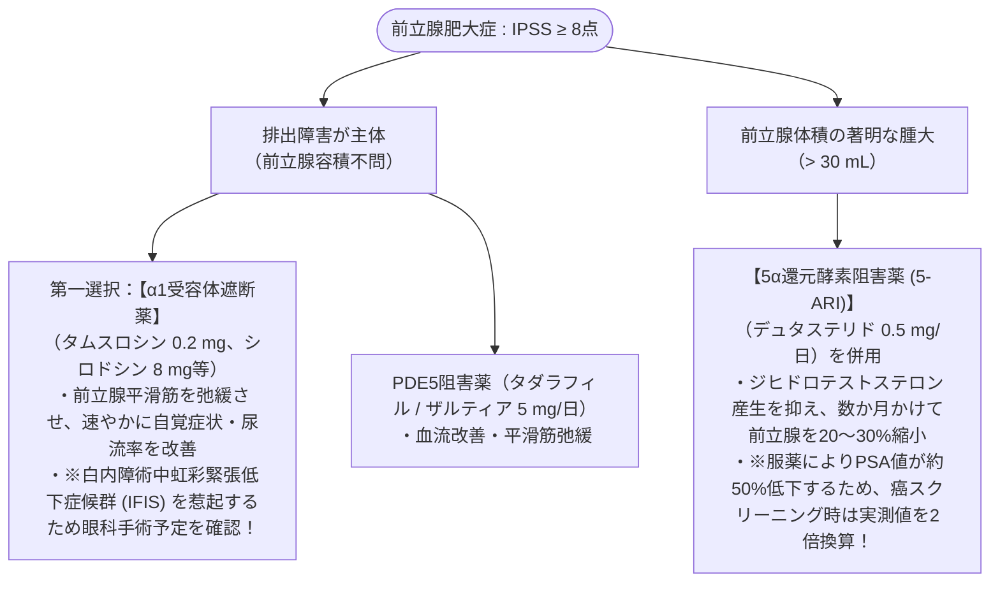

# 前立腺肥大症と神経因性膀胱
親カテゴリ: [[clinical-flows/F_腎・泌尿器/index|F章 腎・泌尿器]]

## 下部尿路症状 (LUTS) の評価
- **蓄尿症状**: 頻尿、夜間頻尿、尿意切迫感、切迫性尿失禁[cite: 509]。
- **排出症状**: 排尿困難、尿線細小、尿勢低下、腹圧排尿[cite: 509]。
- **排尿後症状**: 残尿感、排尿後尿滴下[cite: 509]。
- **質問票**: 国際前立腺症状スコア (IPSS: $\ge8$ 点で中等症以上)[cite: 509, 510]。

---

## 前立腺肥大症 (BPH) の薬物療法

---

## 神経因性膀胱のタイプとアプローチ

排尿筋と尿道括約筋の機能不全パターンで分類する[cite: 513, 514]：

1. **排尿筋過活動（過活動膀胱型：脳血管障害、パーキンソン病、多発性硬化症）**:
   - 尿意切迫感、頻尿が主体[cite: 513, 514]。
   - 治療：抗コリン薬（ソリフェナシン等）または **$\beta_3$受容体作動薬（ミラベグロン、ビベグロン）**[cite: 513, 515]。
2. **排尿筋無収縮・低活動（弛緩性膀胱型：糖尿病性神経障害、骨盤内手術後、馬尾病変）**:
   - 膀胱容量増大、多量の残尿、溢流性尿失禁[cite: 513, 514]。
   - 治療：**自己間欠導尿 (CIC)** が基本[cite: 513, 514]。不用意な抗コリン薬投与は完全尿閉を招くため禁忌[cite: 514]。
