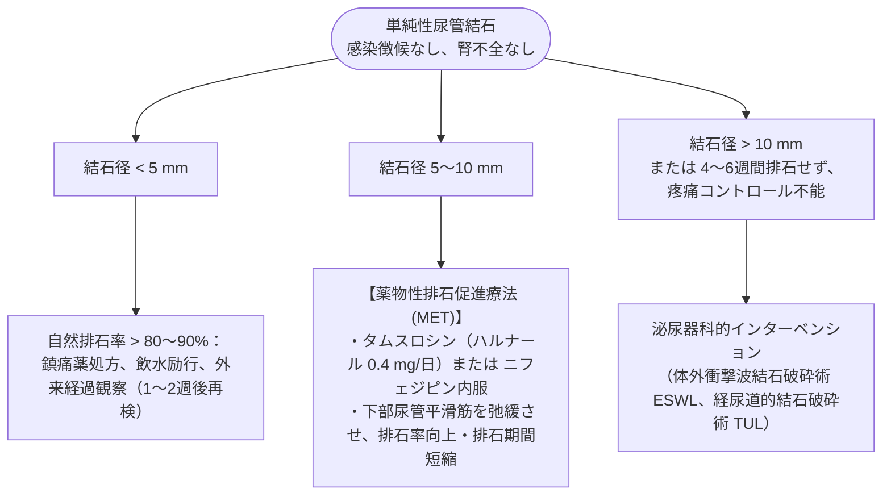

16_尿路結石---
title: 尿路結石
date: 2026-11-03
---

# 尿路結石
親カテゴリ: [[clinical-flows/F_腎・泌尿器/index|F章 腎・泌尿器]]

## 救急トリアージと最優先の除外事項

> [!WARNING]- 閉塞性腎盂腎炎（緊急ドレナージ適応）
> 結石嵌頓による水腎症に細菌感染を併発した状態[cite: 518, 519]。数時間で敗血症性ショック・閉塞性尿管敗血症へ急性転落し致命的となる[cite: 519]。
> - **徴候**: 腎疝痛に**発熱（$>38^\circ\mathrm{C}$）、悪寒戦慄、白血球増多** を認めた場合[cite: 517, 519]。
> - **対応**: 直ちに広域抗菌薬静注を開始し、**緊急で泌尿器科コール（尿管ステント留置または経皮的腎瘻造設術）** を施行する[cite: 517]。

---

## 疼痛コントロールプロトコル

- **第一選択**: **NSAIDs（ジクロフェナク坐剤 50 mg）**[cite: 519, 520]。
  - 腎血流・糸球体濾過圧を低下させ、腎被膜伸展圧を直接抑制するためオピオイドより除痛効果が優れる[cite: 520]。
- **禁忌・無効時**: アセトアミノフェン 1000 mg 静注、または ペンタゾシン 15 mg 静注[cite: 520]。

---

## 結石サイズに基づく排石促進療法 (MET)

---

## 再発予防（生活指導）

- **水分摂取**: 尿量を **$>2.0\sim2.5\ \mathrm{L/day}$** 保持（再発率を半減：RR 0.45）[cite: 521]。
- **カルシウム制限の誤謬**: シュウ酸カルシウム結石患者で食事Caを制限すると、腸管内でのシュウ酸結合が減少し逆に遊離シュウ酸吸収が増大して悪化する。**通常のカルシウム摂取（1000〜1200 mg/日）を維持**し、過剰な動物性蛋白・塩分・シュウ酸多量食品（ほうれん草、紅茶、チョコ）を控える[cite: 521, 522]。
