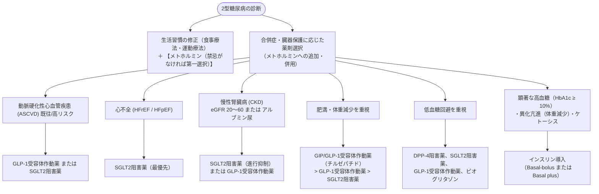

# 2型糖尿病
親カテゴリ: [[clinical-flows/G_代謝・内分泌/index|G章 代謝・内分泌]]

## 目標HbA1c値の個別化設定
治療の基本目標は **HbA1c <7.0%**（合併症予防）とするが、患者背景に応じて設定する[cite: 525, 526]：
- **厳格管理（<6.5%）**: 若年者、罹患期間が短い、低血糖リスクが低い薬剤使用時、微小血管障害の進行阻止目的[cite: 526, 527]。
- **標準管理（<7.0%）**: 一般的な成人糖尿病患者[cite: 525, 526]。
- **緩和管理（7.0〜8.0% または <8.0%）**: 高齢者、認知機能低下、心血管疾患既往、重症低血糖リスクが高い群、期待余命が短い患者[cite: 525, 526, 527]。

---

## 薬物治療選択アルゴリズム

> [!WARNING]- メトホルミンの腎機能別使用基準
> 乳酸アシドーシスを防止するため、eGFRに応じた用量調整を行う[cite: 529]：
> - **eGFR $\ge60\ \mathrm{mL/min/1.73m^2}$**: 通常通り使用可能（最大 2250 mg/日）[cite: 529]。
> - **eGFR $45\sim59\ \mathrm{mL/min/1.73m^2}$**: 最大 1500 mg/日[cite: 529]。
> - **eGFR $30\sim44\ \mathrm{mL/min/1.73m^2}$**: 新規開始は非推奨。継続時は最大 750〜1000 mg/日へ減量[cite: 529]。
> - **eGFR $<30\ \mathrm{mL/min/1.73m^2}$**: **完全禁忌**（直ちに中止）[cite: 529]。
> - 脱水時、ショック時、造影剤使用時、重症急性疾患（シックデイ）時は一時休薬する[cite: 528, 529, 533]。

> [!NOTE]- 新規薬剤：チルゼパチドとイメグリミン
> - **チルゼパチド（マンジャロ）**: GIP/GLP-1受容体デュアルアゴニスト[cite: 531]。強力な血糖降下作用（HbA1c 約2〜3%低下）と著明な体重減少（約5〜11 kg減）を示す（SURPASS試験群）[cite: 529, 531]。痩せ型高齢者への過剰投与には注意[cite: 529, 531]。
> - **イメグリミン（ツイミーグ）**: ミトコンドリア機能改善薬（グルコース濃度依存的インスリン分泌促進と糖新生抑制）[cite: 531]。eGFR $<45\ \mathrm{mL/min}$ では非推奨[cite: 528, 531]。
